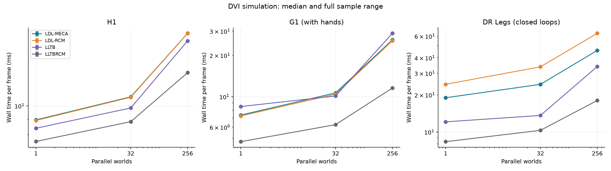
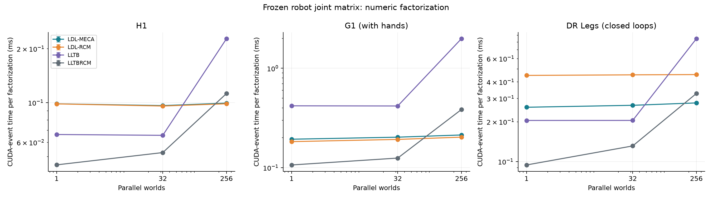
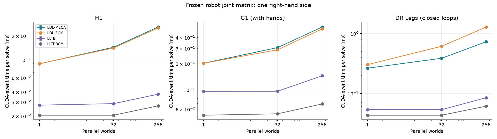
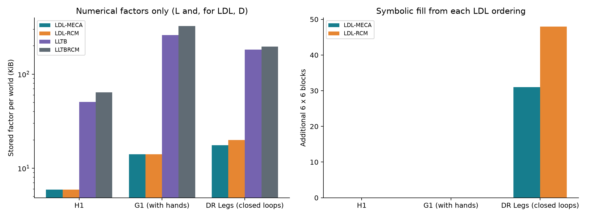
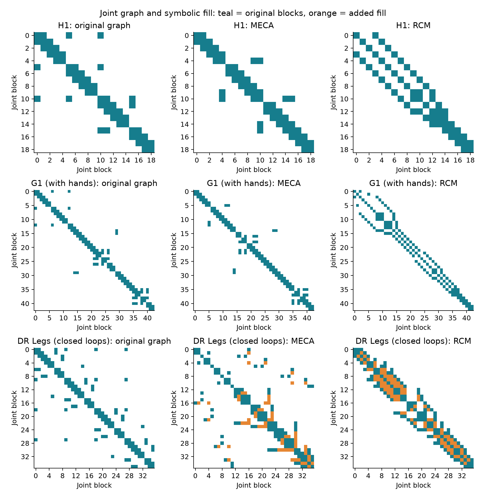

# Kamino DVI: block-sparse LDL versus blocked LLT

Measured 2026-10-24T15:57:49.460887+00:00 on NVIDIA RTX PRO 4500 Blackwell Server Edition, 595.80, 32623 MiB, 165.00 W.
G1 was rerun after correcting contact support and its velocity assertion; see [G1 rerun metadata](g1_audit_metadata.json).

This compares the **same Kamino DVI dynamics solver** with four bilateral joint backends. LDL-MECA and LDL-RCM store unit-lower L and an explicit diagonal D and solve A = L D Lᵀ. LLTB and LLTBRCM use Cholesky A = L Lᵀ. This is not a comparison between the source repository's SolverDVI and Kamino, and it does not benchmark ADMM.

## End-to-end simulation

Each entry is the median synchronized wall time for one frame, in milliseconds, for the entire batch. Lower is better. Timings include collision detection and all physics substeps; they exclude rendering, asset loading, model construction, compilation, capture, and validation downloads.

| Robot | Worlds | LDL-MECA | LDL-RCM | LLTB | LLTBRCM | Fastest |
|---|---:|---:|---:|---:|---:|---|
| H1 | 1 | 8.967 | 8.926 | 8.401 | 7.580 | LLTBRCM |
| H1 | 32 | 10.734 | 10.698 | 9.839 | 8.843 | LLTBRCM |
| H1 | 256 | 17.621 | 17.607 | 16.609 | 12.958 | LLTBRCM |
| G1 (with hands) | 1 | 7.350 | 7.248 | 8.485 | 4.711 | LLTBRCM |
| G1 (with hands) | 32 | 10.665 | 10.442 | 10.126 | 6.261 | LLTBRCM |
| G1 (with hands) | 256 | 25.939 | 25.571 | 28.978 | 11.574 | LLTBRCM |
| DR Legs (closed loops) | 1 | 18.979 | 24.395 | 12.097 | 8.347 | LLTBRCM |
| DR Legs (closed loops) | 32 | 24.382 | 33.835 | 13.629 | 10.322 | LLTBRCM |
| DR Legs (closed loops) | 256 | 46.008 | 63.375 | 34.044 | 18.037 | LLTBRCM |



## What the measurements show

- **LDL-MECA** takes **1.18-2.55x** the time of the faster LLT backend in the same workload (below 1 means faster).
- **LDL-RCM** takes **1.18-3.51x** the time of the faster LLT backend in the same workload (below 1 means faster).
- LDL uses **4.3%-10.2%** of LLTBRCM's numerical factor storage. This measures L and D allocations only, not total solver memory.
- MECA remains the LDL default. A default ordering is not a claim that LDL wins every workload; both orderings and both LLT alternatives remain selectable.
- Compare backends within each robot. Robots have different timesteps, contact geometry, drive parameters, and iteration budgets; frame times across robots are not equal-accuracy comparisons.

## Isolated factorization and solve

For each robot, extract one normalized bilateral matrix after the first LLTB frame. Repeat that exact matrix across the batch and use the same seeded random RHS for every backend. The matrices and joint graphs are saved alongside the report. These measurements exclude physical assembly. LDL uses pre-gathered native sparse values; LLT uses its native dense input. LLTBRCM retains its normal numeric permutation and tile bookkeeping, with the reusable ordering warmed before timing. Factorization includes the configured failed-pivot check/retry path. Solves use already computed factors. A single-RHS microbenchmark does not include the complete DVI Schur/contact response path.





## Storage and fill

This is **stored numerical factor memory**, not peak solver or GPU memory. It includes the full allocated L array, plus D for LDL, and excludes input matrices, symbolic metadata, RHS buffers, collision storage, and Schur workspaces. LDL blocks have six rows with identity padding. LLTBRCM has 32-row capacity padding.

| Robot | Joint rows | Joint blocks | Graph edges | MECA fill | RCM fill | MECA factor KiB | RCM factor KiB | LLTB factor KiB | LLTBRCM factor KiB |
|---|---:|---:|---:|---:|---:|---:|---:|---:|---:|
| H1 | 114 | 19 | 20 | 0 | 0 | 5.93 | 5.93 | 50.77 | 64.00 |
| G1 (with hands) | 258 | 43 | 50 | 0 | 0 | 14.09 | 14.09 | 260.02 | 324.00 |
| DR Legs (closed loops) | 216 | 36 | 52 | 31 | 48 | 17.58 | 19.97 | 182.25 | 196.00 |





The ordering diagram shows structural joint blocks and elimination fill, mirrored across the diagonal for readability. It is not a scalar numerical sparsity plot. MECA minimizes newly created block edges at each elimination; block RCM uses the source DVI traversal. LLTBRCM's separate scalar/tile ordering is not the same permutation as LDL-RCM.

## Numerical and simulation checks

Worst error over the measured batch sizes:

| Robot | Backend | Relative residual ‖Ax-b‖₂/‖b‖₂ | Relative error vs NumPy float64 solve | Backward error (infinity norm) | Retried worlds |
|---|---|---:|---:|---:|---:|
| H1 | LDL-MECA | 1.009e-05 | 1.057e-05 | 3.161e-08 | 0 |
| H1 | LDL-RCM | 5.256e-06 | 9.063e-06 | 1.011e-08 | 0 |
| H1 | LLTB | 2.192e-05 | 4.166e-05 | 7.731e-08 | 0 |
| H1 | LLTBRCM | 1.129e-05 | 6.428e-06 | 3.015e-08 | 0 |
| G1 (with hands) | LDL-MECA | 4.613e-05 | 2.428e-04 | 1.518e-08 | 0 |
| G1 (with hands) | LDL-RCM | 4.740e-05 | 2.783e-04 | 1.433e-08 | 0 |
| G1 (with hands) | LLTB | 7.287e-05 | 3.843e-04 | 1.506e-08 | 0 |
| G1 (with hands) | LLTBRCM | 5.758e-05 | 2.213e-04 | 1.484e-08 | 0 |
| DR Legs (closed loops) | LDL-MECA | 2.228e-02 | 5.387e-02 | 2.584e-08 | 0 |
| DR Legs (closed loops) | LDL-RCM | 2.519e-02 | 4.885e-02 | 1.831e-08 | 0 |
| DR Legs (closed loops) | LLTB | 4.420e-02 | 1.307e-01 | 5.015e-08 | 0 |
| DR Legs (closed loops) | LLTBRCM | 4.986e-02 | 6.041e-02 | 4.308e-08 | 0 |

All **36** cases passed finite-state checks and each existing example's `test_final()` after warmup and after every timed sample. H1 additionally runs its post-settling check at those boundaries. H1/G1 require all bodies above ground and all velocity components below 0.015; DR Legs' existing DVI final check requires finite poses and velocities only. These are fixed-target settling/contact workloads, not locomotion policies or manipulation tasks. In particular, H1 has no balance policy and settles onto the floor; passing its existing check does not mean it remains standing.

The first G1 sweep exposed a validation bug: Warp extracted only `max(abs(qd))` from a multiline predicate and omitted `< 0.015`. A raw velocity of 0.213 in the 256-world LDL-RCM case revealed it. The predicate is now on one source line, with a regression that rejects a moving body and accepts a stationary body. Independent NumPy checks also enforce the bound in the benchmark. Keeping speculative foot contacts, as H1 already does, reduced the worst checkpoint velocity in a 256-world diagnostic from 0.229 to 0.0024. All twelve G1 timing cases were rerun with this same setting for every backend. The final tables use only those corrected G1 runs. See the [untimed diagnostic](g1_contact_diagnostic.json) and [archived initial G1 timings](g1_before_validation_fix.csv).

| Robot | Maximum final body-position difference from LLTBRCM (m, first world) | Maximum absolute velocity component | Matrix condition number |
|---|---:|---:|---:|
| H1 | 8.334e-04 | 1.303e-03 | 1.245e+03 |
| G1 (with hands) | 4.197e-04 | 2.456e-03 | 5.298e+04 |
| DR Legs (closed loops) | 1.107e-04 | 4.923e-04 | 5.549e+06 |

Final-position differences are diagnostics, not proof of trajectory equivalence. Velocity components mix linear m/s and angular rad/s. Full first-world final states are in each raw JSON.

The isolated numerical acceptance criterion is finite solutions, positive LDL pivots, and normwise backward error below 1e-6, where backward error is `||Ax-b||inf / (||A||inf ||x||inf + ||b||inf)`. Relative residual and forward error are reported separately. The initial pilot used a 0.5% forward-error cutoff; DR Legs exceeded it. Its severely ill-conditioned closed-loop matrix amplifies float32 rounding. Small backward error therefore does not imply an accurate solution relative to float64. No iterative refinement or higher-precision factorization is used here; the forward errors above remain a material limitation.

## Method and reproduction

- Host: AMD EPYC-Genoa Processor; full CPU and GPU details are in metadata.json.
- Python `3.12.3`, Warp `1.19.0.dev20261020`, NumPy `2.5.3`.
- Branch `milad/kamino-block-sparse-ldl`; base commit `e806bf53fde2019204645058d932e792447677ec` plus the changes recorded by the tracked-diff and script SHA-256 values in [metadata.json](metadata.json).
- Newton assets pinned to `f8fb7abcbeba2318814a74f3eeb02780ad7925d6`.
- 500 warmup frames, then 5 consecutive samples of 100 frames. No reset between timed samples. Every backend starts from the same example initial conditions. Microbenchmarks use 10 warmup graph launches and 100 launches per sample.
- One fresh process per case, sequential execution, deterministic shuffled order (seed 20261024). CUDA graphs enabled for every backend; float32 factors. Both synchronized wall-clock and CUDA-event sample times are saved. Error bars show the full sample range, not confidence intervals. Clocks are not locked and results are from one GPU; small differences may be run-to-run noise.
- LLTB uses DVI's factor tile 64 and solve block 256. LLTBRCM uses its default tile 32 and capacity stride; DR Legs retains its example's parallel-factorization setting. LDL uses block size 6. All use DVI's failed-pivot shift. No per-case backend tuning was performed.

| Robot | Bodies/world | Substeps/frame | Frame dt (s) |
|---|---:|---:|---:|
| H1 | 20 | 4 | 0.02000000 |
| G1 (with hands) | 44 | 4 | 0.01666667 |
| DR Legs (closed loops) | 31 | 12 | 0.02000000 |

From the repository root, in an environment with the project's dev and examples dependencies and the versions listed above:

```bash
uv run --no-sync python asv/benchmarks/benchmark_kamino_ldl.py --output asv/results/kamino_ldl
uv run --no-sync python asv/benchmarks/plot_kamino_ldl.py --input asv/results/kamino_ldl
```

See [summary.csv](summary.csv) for machine-readable aggregates, [metadata.json](metadata.json) for hardware and configuration, and the per-case JSON files for every timing sample and numerical check. The separate [validation.md](validation.md) records the unit and example regression runs.
