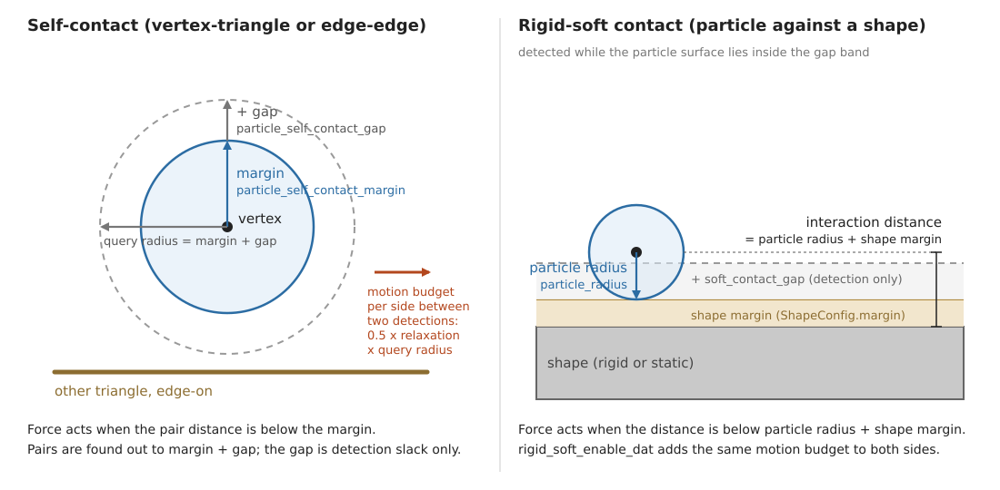
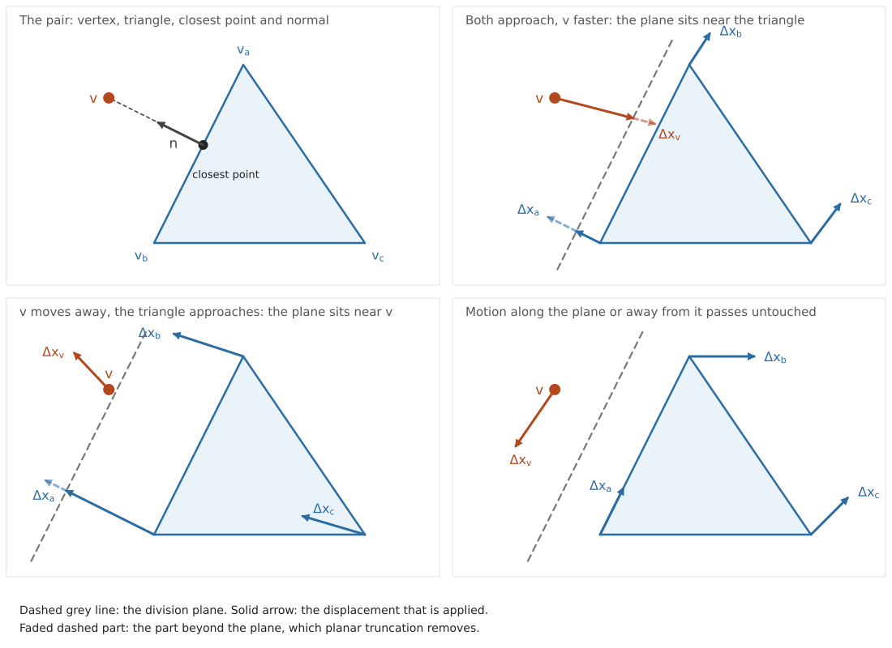
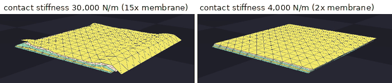
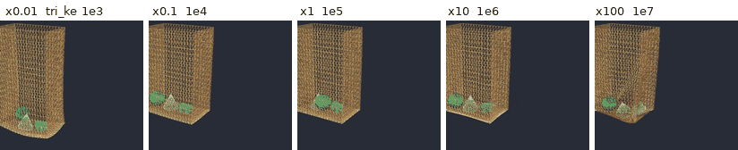
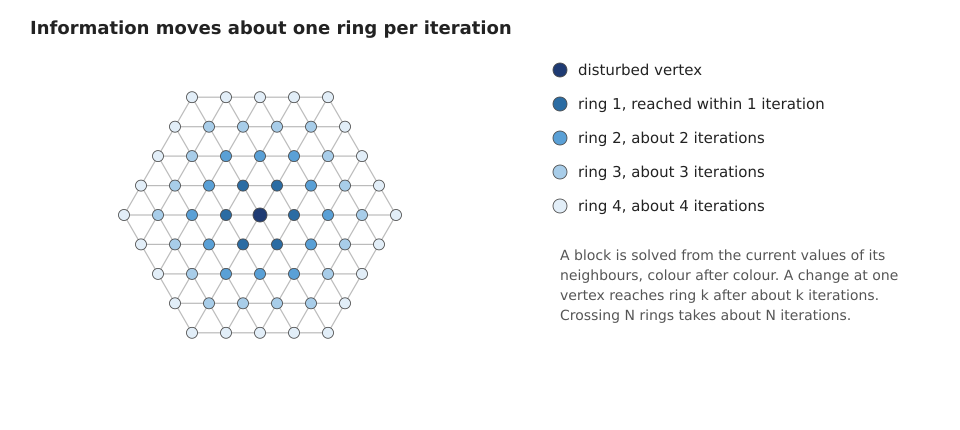

.. SPDX-FileCopyrightText: Copyright (c) 2026 The Newton Developers
.. SPDX-License-Identifier: CC-BY-4.0

.. currentmodule:: newton

.. _Tuning VBD:

VBD Tuning
==========

This page explains how :class:`~newton.solvers.SolverVBD` reacts to its solver
and model parameters, what typically goes wrong and how to fix it, and which
parameter combinations are known to work. It covers cloth (triangle meshes),
soft bodies (tetrahedral meshes), rigid bodies, and cables, including their
contacts.
See :ref:`Tuning Solver Reference` for the parameter reference and
:doc:`VBD </solvers/vbd>` for setup and API explanations.
:ref:`Simulation Tuning` holds the diagnostic workflow that this page assumes.
Check :ref:`Joint feature support` and :ref:`Contact material support` before
tuning your model.

.. important::

   The specific values, mode names, and formulas on this page reflect the code
   at a point in time and can drift. Treat them as starting points and verify
   any you rely on against the cited source (for example
   :class:`~newton.solvers.SolverVBD` and its kernels). See
   :ref:`Simulation Tuning` for the full guidance.

Mental Model
------------

VBD treats every time step as one minimization and solves it one block at a
time. A block is one particle (3 degrees of freedom) or one rigid body (6).
Each block solves a small local problem: with every other block held fixed, it
takes one Newton step that balances its inertia against the forces acting on
it. One pass over all blocks is one iteration, and the solver runs a fixed
number of iterations per step. The material parameters on this page enter
through the energy terms of that minimization, and contacts are energy terms
too; the other parameters control detection, truncation and the iteration.
:ref:`vbd-how-it-works` on the backend page gives the step objective, the
block solve and its call tree, the formula of every energy term, and the
Divide and Truncate scheme (DAT) for particle self-contact and optional
rigid-soft contact.

The consequences for tuning are:

- **Stiff terms win the local solve.** One term far stiffer than the others
  that share its vertices makes the local step serve that term and neglect the
  rest. See :ref:`vbd-stiffness-ratio`.
- **Information moves one ring per iteration.** A vertex sees only the
  vertices it shares an element with, its one ring, so a change travels one
  ring of neighbours per iteration. A fine mesh needs more iterations to reach
  the same state. See :ref:`vbd-fail-resolution`.
- **An unfinished solve becomes velocity.** Corrections that did not settle
  inside the step come back as motion in the next step.
- **DAT caps motion between detections.** DAT keeps contacts penetration-free
  by limiting how far a vertex may move between two contact detections. That
  limit, the motion budget, is a fraction of the distance out to which contact
  pairs are detected, the query radius. A small query radius means a small
  budget and visible DAT damping. See :ref:`vbd-fail-dat-damping`.
- **Float32 sets a floor on the time step.** See :ref:`vbd-fail-small-dt`.

Parameter Effects
-----------------

Four contact distances appear in the tables below; :ref:`vbd-contact-handling`
has the figure, the sums per contact type and the arguments that set them. The
**interaction distance** is where the contact force starts to act. For
particle contacts, it is the self-contact margin, or the particle radius plus
the shape margin for contact with shapes.
The **detection slack** is the extra reach of detection beyond
it, the gap, so that pairs are known before they interact. The **query
radius** is their sum. The **motion budget** is how far one side of a pair may
move between two detections under DAT: half of
``dat_conservative_bound_relaxation`` times the query radius.

.. _vbd-solver-parameters:

VBD-Specific Parameters
~~~~~~~~~~~~~~~~~~~~~~~

The constructor arguments of :class:`~newton.solvers.SolverVBD` that matter
most for tuning. Listed values are built-in fallbacks; the class docstring
is the source of truth. Omitted ``iterations``, ``rigid_contact_history``,
and non-rod joint gains (``rigid_joint_*_ke`` and ``rigid_joint_*_kd``)
can inherit ``model.vbd`` settings.

.. list-table::
   :class: wrap-literals
   :header-rows: 1
   :widths: 27 31 21 21

   * - Parameter
     - What it controls
     - Raise or enable when
     - Cost or risk
   * - ``iterations`` (10)
     - Block-descent sweeps per substep; how far information travels and how
       far the solve converges.
     - The object looks too soft or lags; a finer mesh. For jitter only as the
       last resort, see :ref:`vbd-jitter-pipeline`.
     - Runtime grows linearly. Does not fix a stiffness-ratio problem.
   * - ``friction_epsilon`` (1e-2)
     - Threshold for small sliding speeds [m/s]. Sets particle friction
       smoothing length to ``friction_epsilon`` x ``dt``; also regularizes
       the compliant-ALM body-body friction solve.
     - Particle friction chatters at rest.
     - Slow particle creep under tangential load when large; affects
       finite-iteration convergence for compliant-ALM body-body contacts.
   * - ``dat_conservative_bound_relaxation`` (0.85)
     - Scale of both truncations: how close to its division plane a vertex may
       go, and the radius cap of 0.5 x this x query radius.
     - Rarely; DAT damping with a query radius you cannot raise.
     - Values near 1 leave no safety for detection error.
   * - ``particle_enable_self_contact`` (False)
     - Vertex-triangle and edge-edge self-contact with DAT.
     - Cloth folds or stacks; soft bodies touch themselves.
     - Detection cost; requires a non-``NONE`` self-contact schedule.
   * - ``particle_self_contact_margin`` (0.2)
     - Interaction distance: the surface offset at which self-contact forces
       start. Always pass it together with the gap.
     - Visible gaps between layers are too small; see
       :ref:`vbd-margin-gap-guide`.
     - Rest neighbours beyond the topological filter push each other when it
       exceeds their rest distance.
   * - ``particle_self_contact_gap`` (0)
     - Detection slack: pairs are found out to margin plus gap, and the motion
       budget scales with that sum.
     - Motion looks capped or sticky (DAT damping); fast relative motion.
     - More candidate pairs, larger buffers.
   * - ``particle_vertex_contact_buffer_size`` (32),
       ``particle_edge_contact_buffer_size`` (64)
     - Candidate pairs stored per vertex and per edge. Pairs beyond the
       capacity are dropped silently.
     - Many layers or a large gap; tunneling. See
       :ref:`vbd-fail-tunneling`.
     - Memory, detection time.
   * - ``particle_topological_contact_filter_threshold`` (2)
     - Ring distance under which candidate pairs are discarded.
     - A coarse mesh with a large interaction distance.
     - Values above 3 raise the cost significantly (docstring).
   * - ``particle_rest_shape_contact_exclusion_radius`` (0)
     - Pairs closer than this in the rest shape are never contacts.
     - Seams, layered cloth, or thin regions that are close by design.
     - Real contacts in those regions are missed too.
   * - ``particle_enable_tile_solve`` (True)
     - Tile-based elasticity kernel specialized at construction.
     - Keep on. Rebuild the solver after changing stiffness values.
     - None in normal use.
   * - ``collision_frequency_type``, ``collision_frequency``
       (``SOFT_SELF_CONTACT`` slot)
     - When self-contact detection runs. ``AUTO`` resolves to before and
       after the inertial step. ``ITERATIONS`` with frequency :math:`k`
       detects before the inertial step and then before iterations
       :math:`k, 2k, \ldots`; the pass after the inertial step does not run,
       so a :math:`k` above the iteration count detects less often than
       ``AUTO``.
     - Fast motion with a small gap; for jitter only as the last resort.
     - One detection pass per refresh.
   * - ``rigid_soft_contact_use_log_barrier`` (False)
     - Rigid-soft normal law: quadratic penalty, or the self-contact barrier.
     - Rigid-soft contacts that sink deep under load with the quadratic
       penalty: the barrier force grows like :math:`1/d` as the gap closes.
       It does not stop a crossing; that is ``rigid_soft_enable_dat``.
     - Stiffer local systems, more iterations.
   * - ``rigid_soft_enable_dat`` (False)
     - DAT truncation of rigid pose updates and particles against rigid-soft
       contact planes.
     - Thin cloth between fast rigid parts.
     - Rigid motion is capped by the rigid-soft query radius.
   * - ``rigid_body_particle_contact_buffer_size`` (256)
     - Rigid-soft contact records per body.
     - Dense cloth on a large body; grippers with many vertices in contact.
     - Memory.
   * - ``rigid_body_contact_buffer_size`` (64)
     - Body-body contact records per body.
     - Per-body overflow warnings during impacts or dense packing (see
       :ref:`vbd-contact-buffers`).
     - Memory; contacts beyond the limit are omitted from that body's solve.
   * - ``rigid_contact_history`` (False)
     - Warm-start body-body contact state between steps; requires pipeline
       contact matching (see :ref:`vbd-rigid-contact-history`).
     - Persistent contacts jitter or slip; compare against a history-off
       baseline.
     - Extra computation and memory for matching and history.
   * - ``rigid_joint_linear_ke`` (1e5),
       ``rigid_joint_angular_ke`` (1e5)
     - Non-rod structural joint stiffness in constrained directions
       [N/m, N·m/rad]; separate from drive gains.
     - Joint displacement or rotation under load remains too large after
       checking setup and convergence.
     - Very large values can impede convergence. Rebuild the solver after
       changes.
   * - ``rigid_joint_linear_kd`` (0),
       ``rigid_joint_angular_kd`` (0)
     - Non-rod structural joint damping in constrained directions
       [N·s/m, N·m·s/rad].
     - Constraint-error oscillations persist after release; tune after
       stiffness on an isolated joint.
     - Excessive damping can slow settling after a disturbance. Rebuild the
       solver after changes.

Deprecated aliases remain for one release cycle: ``particle_self_contact_radius``
(legacy radius and margin pair), ``particle_collision_detection_interval``
(now the self-contact slot of the collision schedule) and
``particle_conservative_bound_relaxation`` (now
``dat_conservative_bound_relaxation``). New code should not use them. Passing a
margin without a gap also triggers the legacy meaning of the margin and a
deprecation warning, so always pass both.

.. _vbd-rigid-compliance:

Compliant ALM is the default for rigid constraints. Initially keep
``rigid_avbd_alpha`` and ``rigid_avbd_gamma`` at their defaults. Legacy AVBD
is deprecated and will be removed in a future release. Revalidate scenes
when migrating; the same settings can produce different behavior.

Finite stiffness permits some stretch, joint displacement, or contact
penetration even after convergence. If deformation is larger than expected,
check loads, material values, rest geometry, attachments, and contact setup.
Also check time step and iteration sensitivity rather than relying only on
higher stiffness; see :ref:`Simulation Tuning`.

.. _vbd-rigid-joint-gains:

Choose non-rod structural stiffness for acceptable constrained displacement
or rotation on an isolated joint under load. Then tune damping from
constraint-error decay after release. For cables, see
:ref:`materials and attachments <vbd-cable-inputs>`.

Model Parameters
~~~~~~~~~~~~~~~~

Cloth and soft bodies
`````````````````````

Model parameters are set when the geometry is added, through
:meth:`~newton.ModelBuilder.add_cloth_mesh`,
:meth:`~newton.ModelBuilder.add_cloth_grid`,
:meth:`~newton.ModelBuilder.add_soft_mesh` and
:meth:`~newton.ModelBuilder.add_soft_grid`, under the names below. After
:meth:`~newton.ModelBuilder.finalize` they live on the :class:`~newton.Model`
as the arrays :attr:`~newton.Model.tri_materials`, :attr:`~newton.Model.edge_bending_properties`,
:attr:`~newton.Model.tet_materials`, :attr:`~newton.Model.particle_radius` and :attr:`~newton.Model.particle_mass`, and as the
scalars :attr:`~newton.Model.soft_contact_ke`, :attr:`~newton.Model.soft_contact_kd` and :attr:`~newton.Model.soft_contact_mu`. The
formulas they enter are in :ref:`vbd-energy-terms`.

.. list-table::
   :class: wrap-literals
   :header-rows: 1
   :widths: 24 32 20 24

   * - Parameter
     - What it controls
     - Raise when
     - Cost or risk
   * - :attr:`tri_ke <newton.Model.tri_materials>`, :attr:`tri_ka <newton.Model.tri_materials>` [N/m]
     - Membrane stretch and area stiffness (:math:`\mu` and :math:`\lambda`
       per unit area of the stable Neo-Hookean membrane).
     - Cloth stretches visibly under its own weight.
     - Above about 1e6, slow convergence and jitter under contact; stiffening
       only the membrane moves deformation into bending (see
       :ref:`vbd-fail-membrane-only`).
   * - :attr:`tri_kd <newton.Model.tri_materials>`
     - Membrane damping.
     - In-plane ringing after impacts.
     - Overdamped, slow drape.
   * - :attr:`edge_ke <newton.Model.edge_bending_properties>` [N]
     - Bending stiffness of the dihedral hinge.
     - Cloth folds too sharply or looks too limp.
     - Stiff hinges need more iterations; raise membrane and bending together
       for a stiffer object.
   * - :attr:`edge_kd <newton.Model.edge_bending_properties>`
     - Bending damping.
     - Bending jitter; first knob of the jitter pipeline for cloth without
       contacts.
     - Slow unfolding.
   * - :attr:`k_mu <newton.Model.tet_materials>`, :attr:`k_lambda <newton.Model.tet_materials>` [Pa]
     - Volumetric Neo-Hookean shear and volume stiffness.
     - A soft body sags or inverts too easily.
     - Same ceiling as the membrane; :attr:`k_lambda <newton.Model.tet_materials>` far above :attr:`k_mu <newton.Model.tet_materials>` makes a
       stiff local system.
   * - :attr:`k_damp <newton.Model.tet_materials>` [Pa s]
     - Volumetric viscous damping.
     - Soft-body jitter; the soft-body knob of the jitter pipeline.
     - Slow recovery.
   * - :attr:`~newton.Model.soft_contact_ke` [N/m]
     - Contact stiffness for self-contact; averaged with the shape :attr:`~newton.ModelBuilder.ShapeConfig.ke` for
       rigid-soft contact.
     - Penetration between layers or into shapes that the fix below does not
       cure.
     - Keep within about 10x the elastic stiffness; see
       :ref:`vbd-fail-contact-stiffness`.
   * - :attr:`~newton.Model.soft_contact_kd`
     - Contact damping on the gap rate, active only while approaching.
     - Contact jitter; second knob of the jitter pipeline.
     - Shrinks each correction by enlarging the local matrix; too much slows
       settling.
   * - :attr:`~newton.Model.soft_contact_mu`
     - Friction coefficient (geometric mean with the shape :attr:`~newton.ModelBuilder.ShapeConfig.mu` for
       rigid-soft contact).
     - Cloth slides off a gripper.
     - Sticking, slow sliding.
   * - :attr:`~newton.Model.particle_radius` [m]
     - The particle's half of the rigid-soft interaction distance; also the
       resting offset from shapes.
     - Cloth sinks into shapes.
     - Visible floating; a large radius with a small mesh spacing distorts
       contact geometry.
   * - ``density``, ``mass``
     - Particle masses (per area for cloth, per volume for soft meshes).
     - Never as a fix; set it from the real object.
     - Too small a mass is an explosion cause; see
       :ref:`vbd-explosion-checklist`.
   * - shape :attr:`~newton.ModelBuilder.ShapeConfig.ke`, :attr:`~newton.ModelBuilder.ShapeConfig.kd`, :attr:`~newton.ModelBuilder.ShapeConfig.mu`, :attr:`~newton.ModelBuilder.ShapeConfig.margin`
       (:class:`~newton.ModelBuilder.ShapeConfig`)
     - The shape's half of the rigid-soft material and distance.
     - Set once per object; the shape :attr:`~newton.ModelBuilder.ShapeConfig.margin` adds to the interaction
       distance.
     - :attr:`~newton.ModelBuilder.ShapeConfig.ke` and :attr:`~newton.ModelBuilder.ShapeConfig.kd` are averaged with the particle side; :attr:`~newton.ModelBuilder.ShapeConfig.mu` is the
       geometric mean, so a zero on either side removes friction. The shape
       :attr:`~newton.ModelBuilder.ShapeConfig.gap` is a rigid-rigid broad-phase setting and does not enter
       rigid-soft detection, which uses ``soft_contact_gap``.
   * - ``CollisionPipeline(soft_contact_gap=...)`` (0.01)
     - Rigid-soft detection slack, added on top of particle radius plus shape
       margin.
     - Fast relative motion between cloth and shapes.
     - More rigid-soft records; rigid-soft DAT budget grows with it.
   * - ``vel``
     - Initial velocity of the added geometry.
     - Never as a fix; a large initial velocity is an explosion cause.
     - See :ref:`vbd-explosion-checklist`.

.. _vbd-cable-inputs:

Cables
``````

Create a :class:`Rod` and pass it to :meth:`ModelBuilder.add_rod`; each
segment becomes a capsule body connected to its neighbors by rod joints (see
:ref:`Rod joints`). For capsule contacts, see
:ref:`body-body contacts <vbd-rigid-contacts>`.

Elastic material inputs and section rigidities are two mutually exclusive
ways to specify the material on :class:`Rod`.

.. list-table::
   :class: wrap-literals
   :header-rows: 1
   :widths: 24 32 20 24

   * - Parameter
     - What it controls
     - When to use or adjust
     - Cost or risk
   * - ``youngs_modulus`` [Pa] and ``radius`` [m], plus either
       ``poissons_ratio`` (dimensionless) or ``shear_modulus`` [Pa]
       (:class:`Rod`)
     - Elastic material inputs used to compute section rigidities.
     - Resolution studies at fixed material.
     - Supply exactly one of ``poissons_ratio`` or ``shear_modulus``.
   * - ``stretch_rigidity`` (:math:`EA`), ``shear_rigidity`` (:math:`kGA`) [N],
       ``bend_rigidity`` (:math:`EI`), ``twist_rigidity`` (:math:`GJ`) [N·m²]
       (:class:`Rod`)
     - Axial, shear, bending, and torsional section rigidities.
     - Specify each section response directly while keeping it fixed across
       segment resolutions.
     - All four rigidities must be supplied together.
   * - ``stretch_stiffness``, ``shear_stiffness`` [N/m],
       ``bend_stiffness``, ``twist_stiffness`` [N·m/rad]
       (:meth:`ModelBuilder.add_rod`)
     - Direct per-joint stiffness for each mode (not scaled by segment
       length).
     - Set joint response directly at a fixed segment count.
     - Overrides material-derived values; rescale with segment length when
       changing resolution to preserve the material.
   * - ``stretch_damping``, ``shear_damping`` [N·s/m],
       ``bend_damping``, ``twist_damping`` [N·m·s/rad]
       (:meth:`ModelBuilder.add_rod`)
     - Direct per-joint damping for each mode (not scaled by segment length).
     - Tune oscillation decay after release, after fitting stiffness.
     - Not a damping ratio. Excessive damping makes motion sluggish.

**Stiffness and resolution.** The builder maps each rigidity to joint stiffness
as :math:`R / L_{\mathrm{dual}}`, where :math:`L_{\mathrm{dual}}` is the mean rest
length of the two adjacent segments. This lets resolution studies keep the
intended material fixed.

Without material or section-rigidity inputs on :class:`Rod` or explicit
overrides, ``add_rod`` defaults stretch and shear stiffness to ``1.0e5`` N/m
and bend and twist stiffness to ``0.0`` N·m/rad. See
:meth:`ModelBuilder.add_rod` for topology restrictions.

Refine segment count separately from time step and iterations: the new joint
graph, masses, inertias, and contact workload require another convergence
check. Recheck the damping transient at the final resolution too.

**Initial and rest geometry.** Initial geometry (``points``, ``quaternions``)
and rest geometry (``rest_points``, ``rest_quaternions``) are distinct; rest
defaults to the initial shape. For an ordered chain, ``rest_straight=True``
sets zero intrinsic bend and twist without changing the initial geometry
or segment lengths. Do not supply explicit rest inputs with it. With nonzero
bending stiffness, the cable then tends toward straight. The default
``body_frame_origin="com"`` places the body origin at the segment midpoint;
use the corresponding local offset for an endpoint attachment.

**Attachments and fitting.** Before tuning stiffness, check the initial and
rest orientations and how the cable ends are attached. Fixing only an
endpoint's position allows it to rotate; fixing its orientation as well makes
the attachment clamped.

At a cable attachment, the non-rod joint and adjacent rod joint contribute
to the endpoint body's local solve. Stiffening or refining the cable can
increase attachment error at a fixed time step and iteration count, even
with unchanged attachment gains. Check attachment errors and cable
deformation together when tuning ``rigid_joint_*_ke``. Assess time step
and iteration sensitivity with those gains held fixed.

Fit stretch, shear, bend, and twist stiffness separately under static loads,
then tune damping from oscillation decay after release. Lower stretch
stiffness changes the material; use it only if the extra extension is
acceptable.

**Dahl hysteresis.** Use for history-dependent cable bending and twisting.
Call :meth:`~newton.solvers.SolverVBD.register_custom_attributes` on the
builder before building the model, then set positive ``model.vbd.dahl_eps_max``
and ``model.vbd.dahl_tau`` for the intended rod joints before constructing
the solver. Both default to zero; the affected bend or twist mode also needs
positive stiffness. Tune the Dahl parameters under cyclic loading and
unloading. ``dahl_eps_max`` scales the hysteretic moment relative to stiffness;
``dahl_tau`` sets the deformation scale over which it evolves. See the
:github:`cable bundle hysteresis example <newton/examples/cable/example_cable_bundle_hysteresis.py>`.

Time step, substeps and iterations
``````````````````````````````````

Most shipped examples render at 60 frames per second with 10 substeps, so the
solver runs at ``dt`` = 1/600 s, with 4 to 20 iterations. Start there with 10
iterations. A smaller ``dt`` improves stiffness and convergence, because every
substep adds a full set of iterations and a detection pass. It also costs the
same factor in runtime. Do not go much below 1/3000 s: positions are stored in
float32, and when the per-step update becomes small compared to the position
value, part of each update is rounded away (one float32 unit at 1 m is about
1.2e-7 m). Before that floor, reducing ``dt`` does more for stiffness than
adding iterations. See :ref:`vbd-rules-of-thumb` for the order of operations.

.. _vbd-contact-handling:

Contact Handling
~~~~~~~~~~~~~~~~

Particle contacts
`````````````````

Four distances govern a contact. The **interaction distance** is where the
contact energy starts to act. The **detection slack** is the extra reach of
detection, so pairs are known before they interact. The **query radius** is
their sum. The **motion budget** is how far one side of a pair may move
between two detections under the Divide and Truncate scheme (DAT), the
solver's penetration-free truncation (:ref:`vbd-dat`); it scales with the
query radius. Self-contact pairs are vertex-triangle and edge-edge pairs of
the same particle system; rigid-soft pairs are particles, edges or faces
against a body or static shape.



   Left: self-contact, shown for a vertex-triangle pair; edge-edge pairs use
   the same distances. ``particle_self_contact_margin`` is the interaction
   distance and ``particle_self_contact_gap`` is added on top of it: the two
   stacked arrows sum to the query radius, drawn once more as the horizontal
   arrow. Right: rigid-soft contact, with the particle resting at the
   interaction distance :attr:`~newton.Model.particle_radius` plus the shape :attr:`~newton.ModelBuilder.ShapeConfig.margin`; the
   pipeline's ``soft_contact_gap`` is a detection band beyond that.

In the names of the :class:`~newton.solvers.SolverVBD` constructor arguments,
the :class:`~newton.CollisionPipeline` constructor arguments and the model
arrays, the four distances are:

.. list-table::
   :header-rows: 1
   :widths: 20 40 40
   :class: wrap-literals

   * - Distance
     - Self-contact
     - Rigid-soft contact
   * - Interaction distance
     - ``particle_self_contact_margin`` (solver)
     - :attr:`~newton.Model.particle_radius` + shape
       :attr:`~newton.ModelBuilder.ShapeConfig.margin`
   * - Detection slack
     - ``particle_self_contact_gap`` (solver)
     - ``soft_contact_gap`` (pipeline)
   * - Query radius
     - ``particle_self_contact_margin`` + ``particle_self_contact_gap``
     - ``particle_radius`` + ``margin`` + ``soft_contact_gap``
   * - Motion budget per side
     - 0.5 x ``dat_conservative_bound_relaxation`` x query radius
     - 0.5 x ``dat_conservative_bound_relaxation`` x the smallest rigid-soft
       query radius in the model, with ``rigid_soft_enable_dat``

The force kernels act below the interaction distance; detection finds pairs
out to the query radius. The default self-contact schedule detects before and
after the inertial step of every substep, so the motion budget is refreshed
twice per substep.

**What DAT does to motion.** DAT works on the displacement each vertex has
accumulated since the last detection, and it has two distinct parts. Its knobs
are :class:`~newton.solvers.SolverVBD` constructor arguments
(:ref:`vbd-solver-parameters`): ``dat_conservative_bound_relaxation`` is the
relaxation factor used below (default 0.85), ``particle_self_contact_margin``
and ``particle_self_contact_gap`` set the self-contact query radius,
``rigid_soft_enable_dat`` turns on the rigid-soft part, and
``collision_frequency_type`` with ``collision_frequency`` sets how often
detection refreshes the budget.

*Planar truncation* acts per detected pair. At the detection-time positions
DAT places a division plane between the two primitives. The plane splits the
gap in proportion to how far each side wants to move toward the other, and each
side keeps at least 5 percent of the gap. Each vertex of the pair may then move
only up to its own side of the plane, scaled by the relaxation factor: motion
toward the plane is cut at the plane, motion away from it or along it passes
untouched. A pair whose primitives already intersect at detection time has no
plane and is left unconstrained in that pass.

*Radius truncation* acts on every particle, pair or no pair. The length of the
accumulated displacement is capped at half of the relaxation factor
(``dat_conservative_bound_relaxation``) times the query radius. It is
isotropic: a vertex that wants to move further is slowed
down in every direction, not only along a contact normal. This cap is what
makes the scheme safe between detections: two primitives farther apart than the
query radius at detection cannot meet before the next detection, because each
side moves at most half of the relaxation factor times that radius.

*Rigid-soft DAT* (``rigid_soft_enable_dat``, off by default) applies both
parts to contacts between soft geometry and shapes. Both sides of a contact are
truncated against the same plane: the soft vertices as above, the rigid body by
scaling its whole pose update, translation and rotation together. The budget is
half of the relaxation factor times the smallest rigid-soft query radius (the
pipeline's ``soft_contact_gap`` plus particle radius plus shape margin). It is
fixed when the solver is built, and it caps every dynamic body and particle in
the model while the option is on. Kinematic bodies are not truncated. A pair
without a certifiable separating plane freezes. The option needs a solver-owned
collision pipeline; for fast bodies raise the pipeline gap first, then the
detection frequency (a ``RIGID`` slot on ``ITERATIONS`` needs contact matching
in the pipeline; see :ref:`contact matching <vbd-contact-matching>` on the
solver page). When self-contact is enabled too, the ``RIGID`` and
``SOFT_SELF_CONTACT`` slots must use the same schedule type, and the same
frequency for ``ITERATIONS``; the solver raises otherwise.

Both parts remove motion. A cloth that falls fast onto a shape, or a sheet
pressed between fingers, can therefore move slower than physics would predict,
hover at a fixed offset, or stop. This is DAT damping. The radius cap grows with
the query radius, so the cure is more room: a larger gap first, then a larger
margin.



   Planar truncation for a vertex-triangle pair, redrawn after the DAT paper.
   Top left:
   vertex :math:`v`, triangle :math:`(v_a, v_b, v_c)` and the normal from the
   closest point on the triangle to :math:`v`. The dashed line is the division
   plane. Top right: both sides approach, :math:`v` faster, so the plane
   shifts toward the triangle and gives :math:`v` the larger share of the gap;
   the dashed parts of the displacements, which would cross the plane, are
   truncated. Bottom left: :math:`v` moves away and the triangle approaches,
   so the plane sits close to :math:`v` and the triangle gets almost the whole
   gap. Bottom right: motion that stays on its own side of the plane, along it
   or away from it, passes untouched.

.. _vbd-margin-gap-guide:

Setting margin and gap
''''''''''''''''''''''

There is no single right value. The choice trades physical fidelity against
cost and DAT damping.

**Fidelity first.** The interaction distance is where the contact force starts,
so it is the separation you see between unloaded surfaces. Two cloth layers
rest about one margin apart; a particle rests at about its radius plus the
shape margin from a shape; under load the separation shrinks by the load over
the contact stiffness. Pick the interaction distance from the thickness
you want to show. Pairs more than two rings apart are contact candidates, so an
interaction distance larger than their rest distance creates contact forces at
rest. Where a mesh is close to itself by design, such as seams or layered
panels, use ``particle_rest_shape_contact_exclusion_radius`` instead of a
smaller margin.

.. list-table::
   :header-rows: 1
   :widths: 14 20 18 16 32

   * - Change
     - Cost
     - Separation
     - DAT damping
     - Other effects
   * - Raise the margin
     - More active pairs
     - Larger visible gaps
     - Less (larger budget)
     - Rest neighbours beyond the topological filter can push each other
   * - Raise the gap
     - More candidate pairs, larger buffers, more expensive collision detection
     - None
     - Less (larger budget)
     - Dropped pairs when the buffers overflow
   * - Lower the margin
     - Less
     - Tighter contact
     - More (smaller budget)
     - Without DAT (rigid-soft default) a step that moves further than the
       interaction distance can pass through. With DAT on, tunneling stays
       possible in theory; see :ref:`vbd-fail-tunneling`
   * - Lower the gap
     - Less
     - None
     - More (smaller budget)
     - Fewer candidates; without DAT, pairs that close by more than the query
       radius between two detections are missed

**Starting point and adjustments.** Take the values of the nearest example in
:ref:`the cloth and soft-body example table <vbd-empirical-table>`;
they span 1 mm to 40 mm depending on the scene
scale. Then adjust by symptom: a visible gap between layers means a smaller
margin; slow, hovering or locked motion means a larger gap first and a larger
margin second; dropped pairs (see :ref:`vbd-fail-tunneling`) mean larger
buffers. Keep the gap at about half to one margin unless speed asks for more.

**Stiffness, damping and friction together.** The contact stiffness sets how
far a contact penetrates under load and how stiff the local system becomes.
Keep it within about 10x the elastic stiffness of the material it presses on.
Contact damping only acts while the gap closes and mostly shrinks the per
iteration correction, so it is a second-order knob. Friction scales with the
normal force; a contact that is too soft also has too little friction, which
shows as slipping in grasps.

.. _vbd-rigid-contacts:

Body-body contacts
``````````````````

**Detection first.** Shape geometry, such as a capsule radius, describes the
body; margin shifts the contact surface; gap extends the detection distance.
See :ref:`margin and gap semantics <margin-gap-semantics>`. The builder's
``rigid_gap`` defaults to 0.1 m for shapes without an explicit gap, which can
be large beside a centimeter-scale cable. Set ``builder.default_shape_cfg.gap``
or a shape's ``ShapeConfig.gap`` before adding shapes, then check fast motion
between collision passes. Changing the builder default later does not update
existing shapes. Choose a gap that detects the required contacts reliably.
If those contacts exceed the available capacity, increase the relevant
:ref:`contact buffer <vbd-contact-buffers>`.

**Collision filtering.** Directly jointed body pairs are filtered by default
(``collision_filter_parent``), but other nearby cable segments can still
overlap, especially with short segments or thick capsules. Unfiltered overlaps
can produce unwanted contact forces from the first step. Inspect the initial
geometry and exclude intentionally overlapping neighboring segments whose
collision response is unnecessary throughout the expected motion, using
:meth:`ModelBuilder.add_shape_collision_filter_pair` before ``finalize()``.
Correct unintended initial overlaps, and preserve self-contact needed for
folding and tight bends. Filtering additional neighboring pairs whose
collision response is unnecessary can also reduce contact processing and
buffer demand.

**Normal support before friction.** Check penetration and normal-load support
before increasing ``mu``. VBD mixes body-body ``ke`` and ``kd`` with an
arithmetic mean and ``mu`` with a geometric mean, so one stiff shape can
dominate normal stiffness while a shape with ``mu=0`` makes its pairs
frictionless. Unexpected slip can also come from missing contacts or an
incomplete solve. Leave ``friction_epsilon`` at its default initially;
it does not change the Coulomb limit set by ``mu``.

**Body coloring.** VBD updates bodies in the same color group in parallel.
Automatic coloring uses joint and tendon connections, but does not include
contacts. Contacting bodies may share a color, which can slow convergence.
For small scenes with predictable contacts, consider splitting
existing groups in ``builder.body_color_groups`` to separate frequently
contacting bodies. Make these edits after ``builder.color()`` and before
``builder.finalize()``; calling ``color()`` again replaces them.

Split existing groups without dropping or duplicating bodies; this preserves
the original joint/tendon separation. Custom groups are not fully validated.
More colors reduce parallelism, so compare convergence and runtime.

.. _vbd-rigid-contact-history:

Contact history
'''''''''''''''

Set ``contact_matching`` on :class:`CollisionPipeline` and
``rigid_contact_history`` on :class:`~newton.solvers.SolverVBD`.
Enabling history does not enable matching automatically.

Matching identifies corresponding contacts across collision passes.
With ``rigid_contact_history=True``, VBD uses matches to warm-start contacts
between steps. When a solver-owned pipeline re-detects rigid contacts during
a step (``ITERATIONS``), matches preserve ALM state within that step,
even with ``rigid_contact_history=False``.

For graph capture with contact history, construct the collision pipeline
before ``SolverVBD`` so history buffers are preallocated, or run one
uncaptured solver step with the intended contact buffers before capture.

With history enabled, passing a pipeline with matching disabled to
``SolverVBD`` raises ``ValueError`` at construction. With externally supplied
contacts, VBD raises ``RuntimeError`` during rigid-contact refresh if the
buffer lacks match-index data or reports neither ``"latest"`` nor ``"sticky"``
as its matching mode.

With compliant ALM and ``rigid_contact_history=True``, the matching modes
behave as follows:

.. list-table::
   :header-rows: 1
   :widths: 20 80

   * - ``contact_matching``
     - Behavior
   * - ``"disabled"``
     - Incompatible with history. Use ``rigid_contact_history=False``.
   * - ``"latest"``
     - Keep fresh geometry. Restore normal and projected tangential
       multipliers for valid matches.
   * - ``"sticky"``
     - Replay eligible contact geometry. Restore normal multipliers;
       tangential memory comes from the replayed material anchor.
       This matching mode is experimental.

For a baseline, set ``rigid_contact_history=False`` explicitly. Use
``contact_matching="disabled"`` unless rigid detection uses ``ITERATIONS``,
which requires ``"latest"`` or ``"sticky"`` matching.

Contact history can improve convergence and reduce jitter or unintended slip
for persistent contacts; it does not change the authored friction coefficient.
Compare latest matching plus history against the baseline, measuring drift,
penetration, and total collision plus solver time. Treat sticky matching as
a separate choice: test sliding, separation, and changing contact normals as
well as rest. Increasing ``contact_matching_pos_threshold`` allows matching
across larger position changes; decreasing
``contact_matching_normal_dot_threshold`` allows matching across larger
changes in contact normal. See :ref:`Contact Matching`. Neither mode
guarantees improvement or replaces convergence work.

Contact matching and solver history add computation and memory costs.
Contact matching does not guarantee a deterministic GPU rigid-contact solve.

Warm starts require correspondence to the contact set actually solved in the
previous step. New or unmatched contacts start cold; this is normal.
Alternating contact buffers or colliding twice between steps can cold-start
contacts even with history enabled; see
:class:`~newton.solvers.SolverVBD` for the contact-generation contract.

When a substep reuses contacts without rerunning collision detection, you can
call :meth:`~newton.solvers.SolverVBD.set_rigid_history_update` with ``False`` to
skip rebuilding contact lists and reinitializing contact records. Reuse the
last refreshed contact buffers unchanged, with body mass and kinematic status
unchanged. Per-step contact/joint updates, solving, and enabled history
snapshots still run. Keep refresh enabled after detection or reset. The flag
resets to ``True`` after each step and is independent of
``rigid_contact_history``.

.. _vbd-contact-buffers:

Contact capacity
````````````````

Global storage and per-body adjacency have independent capacities. Increasing
one does not increase the other. :class:`CollisionPipeline` exposes:

- ``rigid_contact_max``: global rigid contact storage.
- ``max_triangle_pairs``: intermediate triangle pairs for mesh/heightfield
  collision and global contact reduction.
- ``contact_reduction_hashtable_size_factor``: global contact-reduction
  hash-table capacity relative to ``max_triangle_pairs``. Increase it for
  hash-table fill/failure warnings.

VBD's ``rigid_body_contact_buffer_size`` (default 64) controls body-body
contact entries per rigid body. Overflow drops contributions from that body's
solve. Keep ``CollisionPipeline(verify_buffers=True)`` diagnostics enabled
while sizing collision buffers and check VBD's per-body overflow warnings
separately. Measure peak demand during impacts, dense packing, and resets,
then allocate headroom; a count at capacity may already be clipped. Check
filters and an unnecessarily large detection gap before allocating more memory.

For rigid-soft contacts, ``rigid_body_particle_contact_buffer_size``
(default 256) is a separate per-body budget. Its overflow falls back to scanning
all stored soft contacts, preserving reactions at extra cost. It cannot recover
contacts lost from the global ``CollisionPipeline.soft_contact_max`` storage.

Particle self-contact uses ``particle_vertex_contact_buffer_size`` and
``particle_edge_contact_buffer_size``; see :ref:`vbd-fail-tunneling` for
overflow checks.

Best Practices
--------------

What Can Go Wrong and How to Fix It
~~~~~~~~~~~~~~~~~~~~~~~~~~~~~~~~~~~

.. list-table::
   :header-rows: 1
   :widths: 28 42 30

   * - Symptom
     - Likely cause
     - Entry
   * - Cloth or a soft body jitters at a few vertices
     - Stiffness ratio: contact far above the elasticity
     - :ref:`vbd-fail-contact-stiffness`
   * - Raising one stiffness does not make the object stiffer
     - Stiffness ratio: the deformation moves into the terms that stayed soft
     - :ref:`vbd-fail-membrane-only`
   * - A fine mesh is soft, laggy or slow to settle
     - About one ring of information per iteration
     - :ref:`vbd-fail-resolution`
   * - Motion is slower than expected, hovers or locks near contact
     - DAT damping, small query radius
     - :ref:`vbd-fail-dat-damping`
   * - Explosion or NaN at a few vertices
     - Bad elements in the asset
     - :ref:`vbd-fail-asset`
   * - A smaller ``dt`` made things worse
     - Compute budget, float32 precision
     - :ref:`vbd-fail-small-dt`
   * - Cloth passes through itself
     - Candidate buffers overflow, or an exclusion filter
     - :ref:`vbd-fail-tunneling`
   * - Unexpected rigid-body or cable motion at startup
     - Initial overlaps, rest geometry, or joint attachment frames
     - :ref:`Startup checks <vbd-rigid-fail-startup>`
   * - Excessive cable stretch or joint displacement
     - Loads, stiffness, rest geometry, attachments, or incomplete convergence
     - :ref:`Deformation checks <vbd-rigid-fail-deformation>`
   * - Excessive body-body penetration, slip, or jitter
     - Detection, capacity, normal support, friction, or incomplete convergence
     - :ref:`Contact checks <vbd-rigid-fail-contact>`
   * - Rigid-body or cable behavior changes unexpectedly after edits or reset
     - Stale solver caches or contact history
     - :ref:`Update and reset checks <vbd-rigid-fail-reset>`

Cloth and soft bodies
`````````````````````

.. _vbd-jitter-pipeline:

Jitter: where to look first
'''''''''''''''''''''''''''

Work through these steps in order and stop at the first one that fixes it.

1. If the scene has self-contacts, check whether the self-contact stiffness is
   disproportionately high. Keep the collision stiffness within 10x of the
   elasticity stiffness: :attr:`~newton.Model.soft_contact_ke` against :attr:`tri_ke <newton.Model.tri_materials>` for cloth or
   :attr:`k_mu <newton.Model.tet_materials>` for soft bodies. This is the stiffness ratio
   (:ref:`vbd-stiffness-ratio`).
2. If not fixed, tune the self-contact damping, :attr:`~newton.Model.soft_contact_kd`.
3. If it is still not fixed, or there is no contact, increase the elasticity
   damping: bending damping :attr:`edge_kd <newton.Model.edge_bending_properties>` for cloth, tet damping :attr:`k_damp <newton.Model.tet_materials>` for
   soft bodies.
4. Increasing the iterations or the collision detection frequency also helps,
   but both increase the computational cost. Only use them as the last resort.
   Iterations: ``iterations``. Detection frequency: set the self-contact slot
   to the ``ITERATIONS`` schedule and give it a frequency,

   .. code-block:: python

      solver = newton.solvers.SolverVBD(
          model,
          particle_enable_self_contact=True,  # plus your margin and gap
          collision_frequency_type={
              newton.solvers.SolverBase.CollisionSlot.SOFT_SELF_CONTACT:
                  newton.solvers.SolverBase.CollisionFrequencyType.ITERATIONS
          },
          collision_frequency={newton.solvers.SolverBase.CollisionSlot.SOFT_SELF_CONTACT: 2},
      )

   which detects before the inertial step and then before every second
   iteration, in place of the pass after the inertial step. With
   ``rigid_soft_enable_dat`` on, give the ``RIGID`` slot the same type and
   frequency; the solver raises in ``step`` otherwise, because the two DAT
   families share one motion reference. A ``RIGID`` slot on ``ITERATIONS``
   re-detects between iterations, and the solver carries each contact's
   multipliers onto the new contact set through the pipeline's contact
   matching. Build the pipeline with ``contact_matching="latest"`` (or
   ``"sticky"``); with the default ``"disabled"`` the constructor raises
   ``ValueError``. The solver page explains the mechanism
   (:ref:`contact matching <vbd-contact-matching>`).

.. _vbd-explosion-checklist:

Explosion: what to check, in this order
'''''''''''''''''''''''''''''''''''''''

1. **Asset quality.** Add the mesh with ``validate_mesh=True`` and read the
   warnings. See :ref:`vbd-fail-asset`.
2. **Density too small?** A light vertex next to a stiff element or contact
   receives a large acceleration. Check ``density`` or ``mass`` against the
   real object; do not lower them to speed things up.
3. **Stiffness too high?** Compare the elastic and contact stiffness with the
   examples in :ref:`the cloth and soft-body example table <vbd-empirical-table>`.
   Above about 1e6 expect trouble.
4. **Initially penetrating?** The validator does not detect intersections; it
   checks element quality and manifoldness only. Inspect the start pose with
   the :ref:`viewer debugging tools <debugging-with-viewers>`. Layers that start
   inside the interaction distance receive a large separating push in the
   first steps.
5. **Initial stretch or velocity too high?** Compare the start positions with
   the rest shape, and check ``vel`` and any prescribed motion in the first
   frame.

.. _vbd-stiffness-ratio:

Stiffness ratio
'''''''''''''''

**Symptom.** One stiffness stands far above the others, and raising it made
things worse instead of better: a few vertices jitter and do not settle with
more iterations, or the object does not get stiffer and even wobbles or
buckles more.

**Cause.** The stiffness ratio. Every term that acts on a vertex enters the
same local system, so one stiffness far above the others impedes the overall
convergence and makes some of the elasticity look less stiff. The pair depends
on the scene: contact against the elasticity of the material it presses on,
membrane against bending, volume against shear (the :attr:`k_mu <newton.Model.tet_materials>`, :attr:`k_lambda <newton.Model.tet_materials>` row
of the model table), and in general any two terms that share vertices.

**Fix.** Keep the stiffnesses of terms that share vertices within about 10x of
each other: lower the one that stands out, or raise the others with it. The
rule is a starting point, not a universal one; after the change, check the
behaviour the stiff term was there for, such as a grasp that must hold or a
sheet that must not stretch. The two cases below are the common ones.

.. _vbd-fail-contact-stiffness:

Example 1: contact stiffness too high compared to the elasticity
^^^^^^^^^^^^^^^^^^^^^^^^^^^^^^^^^^^^^^^^^^^^^^^^^^^^^^^^^^^^^^^^

**Symptom.** Cloth layers or a grasped sheet jitter at a few vertices. The
motion is fast, local, and does not settle when you add iterations.

**Cause.** The stiffness ratio: the contact stiffness is too high compared to
the elasticity.

**Fix.** Bring :attr:`~newton.Model.soft_contact_ke` to within about 10x of the membrane
stiffness (:attr:`tri_ke <newton.Model.tri_materials>`) or the volumetric stiffness (:attr:`k_mu <newton.Model.tet_materials>`), then check that
grasps still hold. Lower contact stiffness also means lower friction force, so
a grasp can slip; in the pouch scene below, lowering the contact stiffness to
2x the membrane stiffness lost the grasp.



   Five stacked cloth layers, the last two seconds of a seven-second rest,
   same time in both runs. Membrane stiffness 2,000 N/m, self-contact margin
   8 mm, gap 8 mm, ``dt`` = 1/300 s, 20 iterations. Left: contact stiffness
   30,000 N/m. Right: 4,000 N/m. The scene is a test scene, not a shipped
   example.

.. list-table::
   :header-rows: 1
   :widths: 40 30 30

   * - Local motion of free vertices, 5 to 50 Hz band, 2 to 7 s
     - Contact stiffness 30,000 N/m
     - Contact stiffness 4,000 N/m
   * - Mean amplitude (RMS over vertices) [mm]
     - 0.93
     - 0.016
   * - 95th percentile vertex [mm]
     - 1.93
     - 0.020
   * - Worst vertex [mm]
     - 4.79
     - 0.024

"Local motion" is the motion of a vertex relative to the mean of its mesh
neighbours, so a rigid shift of the whole stack does not count.

More iterations did not remove this kind of jitter. On a pinched pouch
(membrane 3,000 N/m, contact 50,000 N/m, ``dt`` = 1/300 s) the mean mesh speed
over 0.1 s was 0.123 m/s at 20 iterations, 0.023 m/s at 40, 0.141 m/s at 100
and 0.205 m/s at 200.

**Reproduce.** A similar setup is ``example_vbd_soft_rigid_contact`` with
:attr:`~newton.Model.soft_contact_ke` raised from 1e5 to 1e6 while ``cloth_tri_ke`` stays at 1e5.

.. _vbd-fail-membrane-only:

Example 2: stiffening only the membrane does not stiffen the object
^^^^^^^^^^^^^^^^^^^^^^^^^^^^^^^^^^^^^^^^^^^^^^^^^^^^^^^^^^^^^^^^^^^

**Symptom.** You raise :attr:`tri_ke <newton.Model.tri_materials>` and :attr:`tri_ka <newton.Model.tri_materials>` by orders of magnitude and the
object still wobbles; at the highest values it buckles and wrinkles more.

**Cause.** The stiffness ratio: the membrane is far stiffer than bending. Once
the membrane is near inextensible, the deformation energy moves into bending,
which stayed soft.

**Fix.** Scale :attr:`edge_ke <newton.Model.edge_bending_properties>` together with :attr:`tri_ke <newton.Model.tri_materials>` and :attr:`tri_ka <newton.Model.tri_materials>`. Stiffening
both gives a monotonic stiffening with diminishing returns past the baseline.



   A bag with rigid contents, pinned at the rim, rim driven sideways at
   0.85 Hz, seconds 3 to 6 of the run. Only the membrane stiffness changes,
   :attr:`edge_ke <newton.Model.edge_bending_properties>` stays at 200 N. ``dt`` = 1/600 s, 10 iterations. The x100 bag
   buckles at the bottom. The scene is a test scene, not a shipped example.

.. list-table::
   :header-rows: 1
   :widths: 16 21 21 21 21

   * - Multiplier
     - Stretch score, membrane only
     - Bend score, membrane only
     - Stretch score, both scaled
     - Bend score, both scaled
   * - x0.01
     - 0.114
     - 0.012
     - 0.012
     - 0.033
   * - x0.1
     - 0.015
     - 0.008
     - 0.007
     - 0.018
   * - x1
     - 0.006
     - 0.015
     - 0.006
     - 0.015
   * - x10
     - 0.006
     - 0.045
     - 0.006
     - 0.015
   * - x100
     - 0.006
     - 0.179
     - 0.006
     - 0.015

Baseline x1: :attr:`tri_ke <newton.Model.tri_materials>` 1e5, :attr:`tri_ka <newton.Model.tri_materials>` 2e4, :attr:`edge_ke <newton.Model.edge_bending_properties>` 200. Scores are mean
deformation measures over the last second of each run; lower means stiffer.
Scaling only the membrane leaves the stretch score flat from x1 on and raises
the bend score twelve-fold. Scaling both keeps every score flat.

**Reproduce.** A similar setup is ``example_cloth_hanging`` with :attr:`tri_ke <newton.Model.tri_materials>` and
:attr:`tri_ka <newton.Model.tri_materials>` multiplied by 100 and :attr:`edge_ke <newton.Model.edge_bending_properties>` unchanged, compared with all
three multiplied.

.. _vbd-fail-resolution:

A fine mesh converges slowly
''''''''''''''''''''''''''''

**Symptom.** After refining the mesh, the object looks softer, lags behind
contacts, or needs many more frames to settle, with unchanged material values.

**Cause.** Information moves about one ring per iteration. A block is solved
from the current values of its neighbours, colour by colour, so a change
reaches the next ring within one iteration and crosses :math:`N` rings in
about :math:`N` iterations. At fixed iterations a finer mesh is therefore less
converged at the end of every step.



   A change at one vertex reaches ring :math:`k` after about :math:`k`
   iterations. Refining the mesh by a factor of two doubles the number of
   rings across the object and so, roughly, the iterations needed for the same
   convergence.

**Fix.** Use the lowest resolution that expresses the deformation you need.
When you refine, raise ``iterations`` roughly in proportion to the number of
rings across the object.

.. _vbd-fail-dat-damping:

DAT damping: slow, hovering or locked motion
''''''''''''''''''''''''''''''''''''''''''''

**Symptom.** Near contacts, cloth falls slower than gravity, hovers at a fixed
offset, or a pinched region stops moving.

**Cause.** The motion budget between detections is too small for the motion the
scene asks for. The radius truncation caps the displacement since the last
detection at 0.5 x relaxation x query radius, and the planar truncation stops a
vertex at its division plane, so a small margin and gap cap the speed.

**Fix.** Raise ``particle_self_contact_gap`` first, then
``particle_self_contact_margin``, following :ref:`vbd-margin-gap-guide`. For
rigid-soft contact raise the pipeline's ``soft_contact_gap``. More frequent
detection also refreshes the budget more often, at a cost.

.. _vbd-fail-asset:

Bad asset
'''''''''

**Symptom.** NaN or an explosion at a few vertices from the first frames,
jitter at rest in one region, or warnings when the mesh is added.

**Cause.** Degenerate or sliver elements make the local solve ill-conditioned.

**Fix.** Run the built-in checker, then apply isotropic explicit remeshing.
The checker is opt-in:

.. code-block:: python

   builder.add_cloth_mesh(
       pos=pos, rot=rot, scale=1.0, vel=wp.vec3(0.0),
       vertices=vertices, indices=indices, density=0.1,
       validate_mesh=True, label="shirt",
   )
   builder.add_soft_mesh(
       pos=pos, rot=rot, scale=1.0, vel=wp.vec3(0.0),
       vertices=vertices, indices=tets, density=100.0,
       k_mu=1.0e5, k_lambda=1.0e5, k_damp=1.0,
       validate_mesh=True, label="sponge",
   )

It never raises; it warns and adds the mesh anyway. The same checks are
available directly as :func:`newton.utils.validate_triangle_mesh` and
:func:`newton.utils.validate_tet_mesh`. The checker inspects element quality and
manifoldness; it does not detect intersections between or inside meshes.
Thresholds at the time of writing:

.. list-table::
   :header-rows: 1
   :widths: 18 50 32

   * - Mesh
     - Check
     - Threshold
   * - Triangles
     - Small area
     - below 1 mm² (1e-6 m²)
   * - Triangles
     - Sliver, longest edge over shortest altitude
     - above 20
   * - Triangles
     - Minimum interior angle
     - below 5°
   * - Triangles
     - Non-manifold edge (always checked by the adjacency builder)
     - edge shared by more than two faces
   * - Tetrahedra
     - Inverted element
     - signed volume below 0
   * - Tetrahedra
     - Small volume
     - below 1 mm³ (1e-9 m³)
   * - Tetrahedra
     - Sliver, shape quality :math:`\eta` (1 for a regular tetrahedron)
     - below 0.01
   * - Tetrahedra
     - Non-manifold face
     - face shared by more than two tetrahedra

A warning has this form (the numbers are illustrative):

.. code-block:: text

   NewtonWarning: Mesh quality warning [bag] (873 vertices, 1544 triangles):
     - 4 sliver triangle(s) with aspect ratio > 20.0 (worst: 27.3)
     - 1 triangle(s) with minimum angle < 5.0° (smallest: 4.0°)
   Consider remeshing the input geometry.

Apply isotropic explicit remeshing, for example MeshLab's filter
*Remeshing: Isotropic Explicit Remeshing*, with a target edge length that is
uniform over the asset and larger than the interaction distance. Then add the
mesh with ``validate_mesh=True`` again. Remeshing at a coarse target can still
leave slivers; the checker tells you.

.. _vbd-fail-small-dt:

A smaller time step made things worse
'''''''''''''''''''''''''''''''''''''

**Symptom.** After halving ``dt`` the simulation is slower, and either nothing
improved or the object drifts and loses detail over long runs.

**Cause.** Two effects. First, a smaller ``dt`` costs more substeps per second,
each with collision detection; at a fixed compute budget it takes iterations
away from each substep. Second, positions are float32. A small ``dt`` gives a
small per-step update compared to the position value, so part of each update is
rounded away, and the loss accumulates over time.

**Fix.** Start at ``dt`` = 1/600 s with 10 iterations. Reduce ``dt`` while it
visibly helps, but not below about 1/3000 s. Beyond that, spend the budget on
iterations, or move the scene closer to the origin so that positions are small
numbers.

.. _vbd-fail-tunneling:

Self-contact tunneling
''''''''''''''''''''''

**Symptom.** Cloth passes through itself, or one layer of a stack drops
through another, although self-contact is enabled.

**Cause.** The candidate buffers overflow, or a filter excludes the pair. Each
vertex stores at most ``particle_vertex_contact_buffer_size`` vertex-triangle
candidates (default 32) and each edge at most
``particle_edge_contact_buffer_size`` edge-edge candidates (default 64). Pairs
beyond the capacity are dropped silently, and a dropped pair has no force and
no division plane; only the radius cap still limits its vertices. The
topological filter and the rest-shape exclusion radius also
remove pairs, by design.

**Fix.** Raise the two buffer sizes, and lower the gap if it is far above the
margin. The detector records the number of pairs found per vertex and per edge,
including the dropped ones, next to the buffer sizes. A count above the buffer
size is a measured overflow. The result struct is reachable as
``solver.trimesh_collision_info`` (fields ``vertex_colliding_triangles_count``,
``vertex_colliding_triangles_buffer_sizes``, ``edge_colliding_edges_count`` and
``edge_colliding_edges_buffer_sizes``); it is an experimental type and can
change. If a filter is the cause, lower
``particle_rest_shape_contact_exclusion_radius`` or check the external filter
maps you passed.

.. _vbd-rigid-problems:

Rigid bodies and cables
```````````````````````

.. _vbd-rigid-fail-startup:

Unexpected motion at startup
''''''''''''''''''''''''''''

Check initial overlaps, cable rest geometry, and joint attachment frames.
Adjust the initial geometry to remove unintended overlaps. Exclude
intentionally overlapping neighboring segments only if their collision
response is unnecessary throughout the expected motion. See
:ref:`cable inputs <vbd-cable-inputs>` and
:ref:`rigid contact setup <vbd-rigid-contacts>`.

.. _vbd-rigid-fail-deformation:

Excessive stretch or joint displacement
'''''''''''''''''''''''''''''''''''''''

Check loads, stiffness inputs, rest geometry, and attachments. Also check
time step and iteration sensitivity with those inputs held fixed.
:ref:`Finite stiffness <vbd-rigid-compliance>` permits some deformation; see
:ref:`cable materials and attachments <vbd-cable-inputs>` and
:ref:`non-rod joint gains <vbd-rigid-joint-gains>`.

.. _vbd-rigid-fail-contact:

Excessive penetration, unexpected slip, or jitter
'''''''''''''''''''''''''''''''''''''''''''''''''

Check contact detection, including fast motion between collision passes,
buffer overflow, and normal-load support. For unexpected slip, check both
shapes' ``mu`` values and joint/contact convergence.
For persistent contacts, compare
:ref:`contact history <vbd-rigid-contact-history>` against a baseline.
See :ref:`rigid contact setup <vbd-rigid-contacts>` and
:ref:`contact capacity <vbd-contact-buffers>`.

.. _vbd-rigid-fail-reset:

Unexpected behavior after edits or reset
''''''''''''''''''''''''''''''''''''''''

Check whether a model edit requires
:meth:`~newton.solvers.SolverVBD.notify_model_changed` or rebuilding
the solver. For resets, clear solver and collision-pipeline history and
regenerate contacts at the final pose. See
:ref:`model changes and reset <vbd-rigid-model-updates>`.

.. _vbd-rigid-model-updates:

Model Changes and Reset
~~~~~~~~~~~~~~~~~~~~~~~

Create a new ``SolverVBD`` after changing construction-only settings. When
using the tiled particle solve (``particle_enable_tile_solve``), also rebuild
after changing triangle or edge stiffness. For rigid bodies and cables,
rebuild after changing joint topology or DOF layout, or the non-rod reference
configuration used to initialize drive/limit angle offsets.

Rod stiffness and damping can be updated during simulation. VBD caches the
rod gains and requires equal X/Y shear and X/Y bend coefficients on each rod
joint. After editing model properties, call
:meth:`~newton.solvers.SolverVBD.notify_model_changed` with the matching flag
before the next step:

- :attr:`ModelFlags.JOINT_DOF_PROPERTIES` for rod gains in
  ``model.joint_target_ke`` or ``model.joint_target_kd``.
- :attr:`ModelFlags.JOINT_REFERENCE_POSE_PROPERTIES` for rod rest
  rotations in ``model.joint_rest_q``.
- :attr:`ModelFlags.JOINT_PROPERTIES` after toggling ``model.joint_enabled``.
- :attr:`ModelFlags.BODY_PROPERTIES` after changing kinematic flags.
- :attr:`ModelFlags.BODY_INERTIAL_PROPERTIES` after changing body mass or inertia.

When editing mass or inertia directly, keep ``model.body_inv_mass`` and
``model.body_inv_inertia`` consistent with them. The notification refreshes
solver caches; it does not recompute these model arrays.

When VBD integrates rigid bodies, it advances ``state.body_q`` and
``state.body_qd`` directly. :meth:`~newton.solvers.SolverVBD.step` does not
synchronize ``state.joint_q`` or ``state.joint_qd``; call :func:`eval_ik`
explicitly when joint coordinates or velocities are needed from body state.

For an episode reset, call :meth:`~newton.solvers.SolverVBD.reset` to clear
rigid solver history. By default, it also restores particle positions and
velocities and VBD-integrated body poses and velocities from the model
defaults. For a custom reset, assign ``state.body_q`` and
``state.body_qd`` and use ``flags=0`` to preserve them. Set velocities to zero
for a reset to rest. If authoring the reset in joint coordinates, run
:func:`eval_fk` after reset to populate the body poses and velocities. Finish
all state edits before the next step.

Also call :meth:`CollisionPipeline.reset_contact_matching` with the same
world mask to discard correspondence and sticky geometry. Regenerate contacts
at the final pose and leave rigid-history refresh enabled for the next
contact-bearing step. See :meth:`~newton.solvers.SolverVBD.reset` for
partial-world and coupled-solver behavior.

Examples
~~~~~~~~

.. _vbd-empirical-table:

Cloth and soft bodies
`````````````````````

Start from an example, not from material data. Stiffness values derived from
measured material properties (Young's modulus, Poisson ratio, thickness) are
usually far too high for VBD to converge at practical iteration counts. Each
shipped example below is a working combination of material, contact and
time-step values for its scenario. Open the example file for the complete
configuration; the examples are maintained with the solver, so their values are
the ones to copy. The resemblance given for each scenario is visual, at the
example's scale, not a material measurement.

.. list-table::
   :header-rows: 1
   :widths: 20 30 50

   * - Scenario
     - Example
     - What it demonstrates
   * - Cloth drape
     - :github:`cloth_hanging <newton/examples/cloth/example_cloth_hanging.py>`
       (run with ``--solver vbd``)
     - A planar cloth fixed on one side hangs under gravity and settles on the
       ground. Resembles a heavy cotton sheet at a coarse scale.
   * - Cloth with a robot
     - :github:`cloth_franka <newton/examples/cloth/example_cloth_franka.py>`
     - A Franka arm folds a shirt: VBD cloth coupled with a Featherstone robot,
       in centimetre scale. Resembles cotton cloth handled by a gripper.
   * - Stiff sheets
     - :github:`cloth_poker_cards <newton/examples/cloth/example_cloth_poker_cards.py>`
     - 52 cards stack on a cube and are knocked off by a sphere; high bending
       stiffness keeps their shape. Resembles playing cards, cardboard.
   * - Inextensible sheet
     - :github:`cloth_stiff_material_hanging <newton/examples/vbd/example_cloth_stiff_material_hanging.py>`
     - A curtain pinned along one edge swings and settles with very stiff
       membrane values. Resembles a plastic membrane that drapes but does not
       stretch.
   * - Soft-body beams
     - :github:`softbody_hanging <newton/examples/softbody/example_softbody_hanging.py>`
     - Four tetrahedral beams hang with damping from 1e4 down to 1e1, showing
       what damping does to Neo-Hookean behaviour. Resembles rubber to foam
       beams, depending on the damping.
   * - Soft box with ribbon
     - :github:`softbody_gift <newton/examples/multiphysics/example_softbody_gift.py>`
     - Four soft blocks tied by cloth straps drop and bounce while the straps
       hold the stack together. Resembles a foam box with a thin ribbon.
   * - Soft-body grasp
     - :github:`softbody_franka <newton/examples/softbody/example_softbody_franka.py>`
     - A Franka arm grasps, lifts and drops a tetrahedral rubber duck.
       Resembles a firm rubber block in a gripper.
   * - Thin bags with contents
     - :github:`vbd_soft_rigid_contact <newton/examples/vbd/example_vbd_soft_rigid_contact.py>`
     - Six cloth bags each hold a different rigid shape type; the bags settle,
       then lift their contents, so rigid-soft contact can be inspected per
       shape type. Resembles plastic bags holding rigid objects.
   * - Tarp under fast impacts
     - :github:`vbd_dat_rigid_soft <newton/examples/multiphysics/example_vbd_dat_rigid_soft.py>`
     - Heavy, fast projectiles hit sheets that catch them; rigid-soft DAT keeps
       the cloth outside the bodies where contact stiffness alone cannot.
       Resembles a tarp struck by thrown objects.
   * - Gripper on a soft pad
     - :github:`vbd_gripper_soft_grid <newton/examples/vbd/example_vbd_gripper_soft_grid.py>`
     - A parallel-jaw gripper pinches a two-triangle grid on its interior edge
       and lifts it, which needs full-surface rigid-soft contact. Resembles a
       foam pad pinched and lifted.

.. _vbd-cable-examples:

Cables
``````

These examples demonstrate cable setup and behavior:

.. list-table::
   :header-rows: 1
   :widths: 20 30 50

   * - Scenario
     - Example
     - What it demonstrates
   * - Initial and rest shapes
     - :github:`cable_initial_rest_pose <newton/examples/cable/example_cable_initial_rest_pose.py>`
     - Cables relax toward rest shapes that differ from their initial geometry.
   * - Driven twist
     - :github:`cable_twist <newton/examples/cable/example_cable_twist.py>`
     - Twist propagates through bent cables with different angular stiffnesses.
   * - Bending hysteresis
     - :github:`cable_bundle_hysteresis <newton/examples/cable/example_cable_bundle_hysteresis.py>`
     - Cyclic bending leaves residual curvature; compare with ``--no-dahl``
       for the elastic response.
   * - Cable-driven table
     - :github:`cable_cross_slide_table <newton/examples/cable/example_cable_cross_slide_table.py>`
     - Driven pulleys move two carriages through a cable loop with wrapping
       contact.
   * - Dense cable pile
     - :github:`cable_pile <newton/examples/cable/example_cable_pile.py>`
     - A cable pile settles under gravity with cable-cable contact and friction.

Run, for example, ``python -m newton.examples cable_initial_rest_pose``.
Example settings are specific to each scene; check convergence before reusing
them.

.. _vbd-rules-of-thumb:

Rules of Thumb
~~~~~~~~~~~~~~

The following rules apply to cloth and soft bodies:

- Use the lowest resolution that expresses the deformation you need. Raise it
  only when the degrees of freedom are not enough.
- Use a uniform triangulation with good element quality. Check it with
  ``validate_mesh=True``, and apply isotropic explicit remeshing when it
  warns.
- Start at ``dt`` = 1/600 s and 10 iterations, and adjust from there. If you
  start from a shipped example, keep its values.
- Keep a copy of the last working configuration and change one parameter at a
  time, so you know what each change did and can go back. The
  :ref:`Simulation Tuning` page explains the one-knob rule.
- Start from the paradigm example closest to your task: ``cloth_hanging`` for
  cloth simulation, ``cloth_franka`` for cloth manipulation,
  ``softbody_hanging`` and ``softbody_franka`` for soft bodies,
  ``vbd_gripper_soft_grid`` for grippers.
- Keep the collision stiffness within 10x of the elasticity stiffness. A
  contact that is far stiffer than the material it presses on jitters.
- Always pass the self-contact margin and gap together, and keep the gap at
  about half to one margin. Raise the gap before the margin when motion looks
  damped near contacts.
- Scale membrane and bending stiffness together. Stiffening only the membrane
  moves the deformation into bending.
- Do not blindly crank up stiffness. It can be challenging for VBD to simulate
  a stiffness higher than about 1e6; a static drape can still work at higher
  values, as ``cloth_stiff_material_hanging`` shows at 1e8. If your stiffness
  is already very high, cranking it up further is unlikely to help and only
  creates more artifacts from the stiffness ratio. Look into, in this order:
  the resolution (is such a high resolution necessary? reducing it immediately
  improves convergence and so increases stiffness); the stiffness ratio (one
  stiffness far above the others impedes the overall convergence and makes
  some of the elasticity look less stiff, see :ref:`vbd-stiffness-ratio`);
  then the time step (reducing it always helps, but not below about 1/3000 s;
  more iterations also help, and before ``dt`` gets too small, reducing ``dt``
  improves stiffness more than adding iterations).
- Start from an example's values, not from measured material data. Derived
  stiffness values are usually too high for VBD to simulate.
- Increasing the iterations or the collision detection frequency helps, but
  both increase the computational cost. Use them as the last resort.
