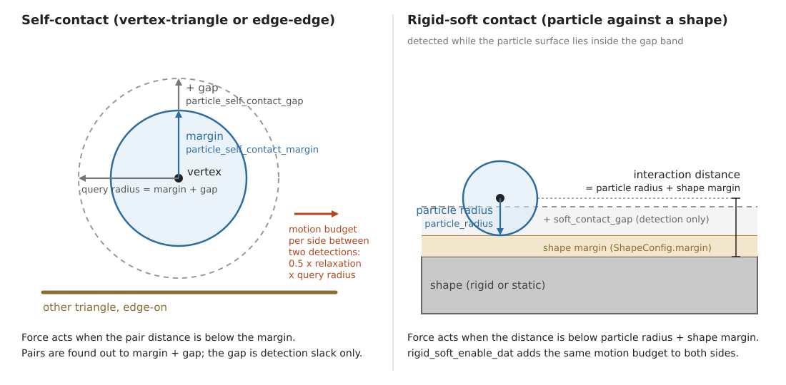
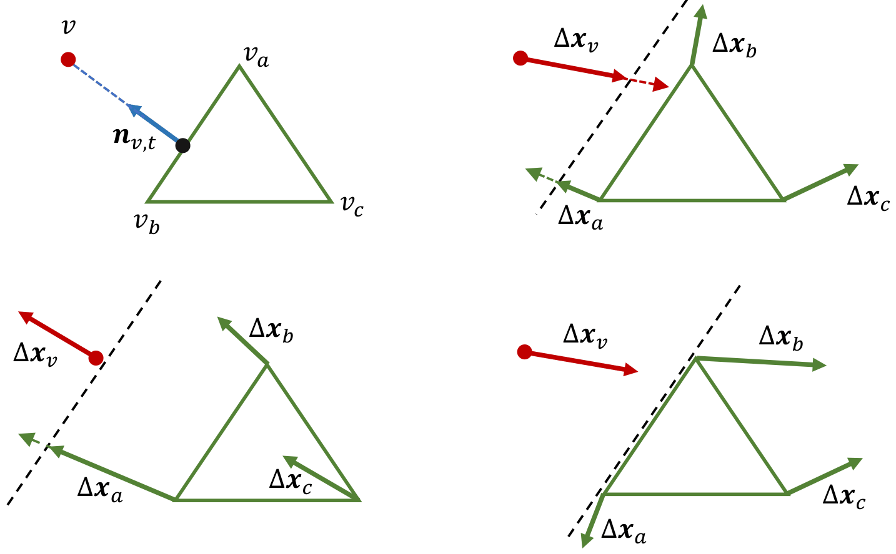
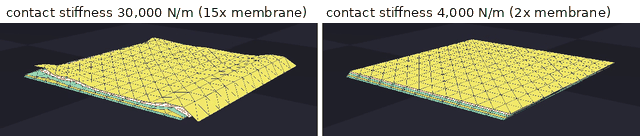
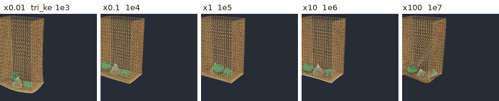
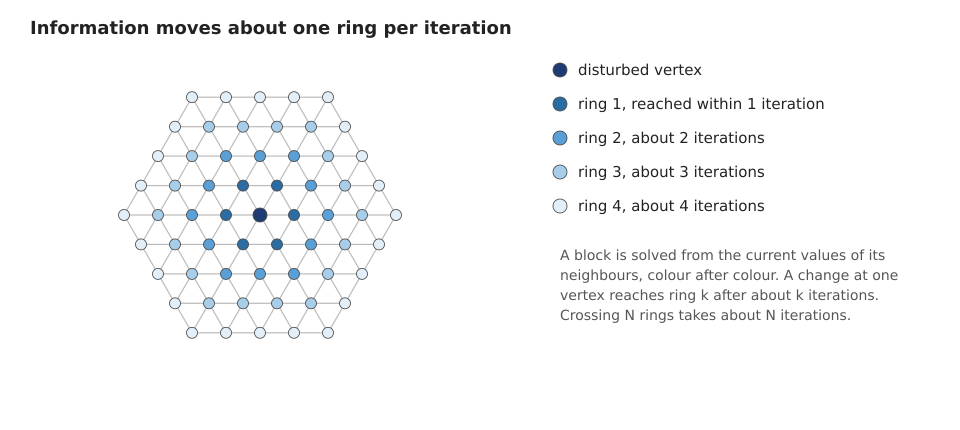

.. SPDX-FileCopyrightText: Copyright (c) 2026 The Newton Developers
.. SPDX-License-Identifier: CC-BY-4.0

.. currentmodule:: newton

.. _Tuning VBD:

VBD Tuning
==========

This page explains how :class:`~newton.solvers.SolverVBD` reacts to its solver
and model parameters, what typically goes wrong and how to fix it, and which
parameter combinations are known to work. It covers particle systems: cloth
(triangle meshes) and soft bodies (tetrahedral meshes), their self-contact, and
their contact with rigid and static shapes, grippers included. Rods, cables and
rigid articulations are out of scope here; see :ref:`Tuning Solver Reference`
for their knobs and :doc:`VBD </solvers/vbd>` for setup and API explanations.
:ref:`Simulation Tuning` holds the diagnostic workflow that this page assumes.

.. important::

   The specific values, mode names, and formulas on this page reflect the code
   at a point in time and can drift. Treat them as starting points and verify
   any you rely on against the cited source (for example
   :class:`~newton.solvers.SolverVBD` and its kernels). See
   :ref:`Simulation Tuning` for the full guidance.

Mental Model
------------

VBD treats every time step as one minimization and solves it one block at a
time: a particle block has 3 degrees of freedom and a 3x3 local solve, a rigid
body block has 6 and a 6x6 solve. Every parameter on this page enters through
one of the energy terms of that minimization, and contacts are energy terms
too. :ref:`vbd-how-it-works` on the backend page gives the step objective, the
block solve and its call tree, the formula of every energy term, and the
penetration-free truncation (DAT). The consequences for tuning are:

- Stiff terms dominate :math:`\mathbf{H}_i`. A contact that is far stiffer than
  the elasticity makes the local step serve the contact and neglect the rest.
  See :ref:`vbd-fail-contact-stiffness`.
- Information moves one ring per iteration. A fine mesh needs more iterations
  to reach the same state. See :ref:`vbd-fail-resolution`.
- An unfinished solve becomes velocity. Corrections that did not settle inside
  the step come back as motion in the next step.
- Truncation removes motion. A small query radius means a small budget and
  visible DAT damping. See :ref:`vbd-fail-dat-damping`.
- Float32 sets a floor on the time step. See :ref:`vbd-fail-small-dt`.

Parameter Effects
-----------------

VBD-Specific Parameters
~~~~~~~~~~~~~~~~~~~~~~~

The constructor arguments of :class:`~newton.solvers.SolverVBD` that matter for
particle systems. Defaults are those of the constructor at the time of
writing; the class docstring is the source of truth.

.. list-table::
   :class: wrap-literals
   :header-rows: 1
   :widths: 27 31 21 21

   * - Parameter
     - What it controls
     - Raise or enable when
     - Cost or risk
   * - ``iterations`` (10)
     - Block-descent sweeps per substep; how far information travels and how
       far the solve converges.
     - The object looks too soft or lags; a finer mesh. For jitter only as the
       last resort, see :ref:`vbd-jitter-pipeline`.
     - Runtime grows linearly. Does not fix a stiffness-ratio problem.
   * - ``friction_epsilon`` (1e-2)
     - Relative velocity below which friction is smoothed; the smoothing
       length is ``friction_epsilon`` x ``dt``.
     - Friction chatters at rest.
     - Slow creep under tangential load when large.
   * - ``dat_conservative_bound_relaxation`` (0.85)
     - Scale of both truncations: how close to its division plane a vertex may
       go, and the radius cap of 0.5 x this x query radius.
     - Rarely; DAT damping with a query radius you cannot raise.
     - Values near 1 leave no safety for detection error.
   * - ``particle_enable_self_contact`` (False)
     - Vertex-triangle and edge-edge self-contact with DAT.
     - Cloth folds or stacks; soft bodies touch themselves.
     - Detection cost; requires a non-``NONE`` self-contact schedule.
   * - ``particle_self_contact_margin`` (0.2)
     - Interaction distance: the surface offset at which self-contact forces
       start. Always pass it together with the gap.
     - Visible gaps between layers are too small; see
       :ref:`vbd-margin-gap-guide`.
     - Rest neighbours beyond the topological filter push each other when it
       exceeds their rest distance.
   * - ``particle_self_contact_gap`` (0)
     - Detection slack: pairs are found out to margin plus gap, and the motion
       budget scales with that sum.
     - Motion looks capped or sticky (DAT damping); fast relative motion.
     - More candidate pairs, larger buffers.
   * - ``particle_vertex_contact_buffer_size`` (32),
       ``particle_edge_contact_buffer_size`` (64)
     - Candidate pairs stored per vertex and per edge. Pairs beyond the
       capacity are dropped silently.
     - Many layers or a large gap; tunneling. See
       :ref:`vbd-fail-tunneling`.
     - Memory, detection time.
   * - ``particle_topological_contact_filter_threshold`` (2)
     - Ring distance under which candidate pairs are discarded.
     - A coarse mesh with a large interaction distance.
     - Values above 3 raise the cost significantly (docstring).
   * - ``particle_rest_shape_contact_exclusion_radius`` (0)
     - Pairs closer than this in the rest shape are never contacts.
     - Seams, layered cloth, or thin regions that are close by design.
     - Real contacts in those regions are missed too.
   * - ``particle_enable_tile_solve`` (True)
     - Tile-based elasticity kernel specialized at construction.
     - Keep on. Rebuild the solver after changing stiffness values.
     - None in normal use.
   * - ``collision_frequency_type``, ``collision_frequency``
       (``SOFT_SELF_CONTACT`` slot)
     - When self-contact detection runs. ``AUTO`` resolves to before and
       after the inertial step. ``ITERATIONS`` with frequency :math:`k` also
       detects before iterations :math:`k, 2k, \ldots`
     - Fast motion with a small gap; for jitter only as the last resort.
     - One detection pass per refresh.
   * - ``rigid_soft_contact_use_log_barrier`` (False)
     - Rigid-soft normal law: quadratic penalty, or the self-contact barrier.
     - A gripper must never let a thin sheet through.
     - Stiffer local systems, more iterations.
   * - ``rigid_soft_enable_dat`` (False)
     - DAT truncation of rigid pose updates and particles against rigid-soft
       contact planes.
     - Thin cloth between fast rigid parts.
     - Rigid motion is capped by the rigid-soft query radius.
   * - ``rigid_body_particle_contact_buffer_size`` (256)
     - Rigid-soft contact records per body.
     - Dense cloth on a large body; grippers with many vertices in contact.
     - Memory.

Deprecated aliases remain for one release cycle: ``particle_self_contact_radius``
(legacy radius and margin pair), ``particle_collision_detection_interval``
(now the self-contact slot of the collision schedule) and
``particle_conservative_bound_relaxation`` (now
``dat_conservative_bound_relaxation``). New code should not use them. Passing a
margin without a gap also triggers the legacy meaning of the margin and a
deprecation warning, so always pass both.

Model Parameters
~~~~~~~~~~~~~~~~

Model parameters are set when the geometry is added, through
:meth:`~newton.ModelBuilder.add_cloth_mesh`,
:meth:`~newton.ModelBuilder.add_cloth_grid`,
:meth:`~newton.ModelBuilder.add_soft_mesh` and
:meth:`~newton.ModelBuilder.add_soft_grid`, or on the
:class:`~newton.Model` after :meth:`~newton.ModelBuilder.finalize`. The
formulas they enter are in :ref:`vbd-energy-terms`.

.. list-table::
   :class: wrap-literals
   :header-rows: 1
   :widths: 24 32 20 24

   * - Parameter
     - What it controls
     - Raise when
     - Cost or risk
   * - ``tri_ke``, ``tri_ka`` [N/m]
     - Membrane stretch and area stiffness (:math:`\mu` and :math:`\lambda`
       per unit area of the stable Neo-Hookean membrane).
     - Cloth stretches visibly under its own weight.
     - Above about 1e6, slow convergence and jitter under contact; stiffening
       only the membrane moves deformation into bending (see
       :ref:`vbd-fail-membrane-only`).
   * - ``tri_kd``
     - Membrane damping.
     - In-plane ringing after impacts.
     - Overdamped, slow drape.
   * - ``edge_ke`` [N]
     - Bending stiffness of the dihedral hinge.
     - Cloth folds too sharply or looks too limp.
     - Stiff hinges need more iterations; raise membrane and bending together
       for a stiffer object.
   * - ``edge_kd``
     - Bending damping.
     - Bending jitter; first knob of the jitter pipeline for cloth without
       contacts.
     - Slow unfolding.
   * - ``k_mu``, ``k_lambda`` [Pa]
     - Volumetric Neo-Hookean shear and volume stiffness.
     - A soft body sags or inverts too easily.
     - Same ceiling as the membrane; ``k_lambda`` far above ``k_mu`` makes a
       stiff local system.
   * - ``k_damp`` [Pa s]
     - Volumetric viscous damping.
     - Soft-body jitter; the soft-body knob of the jitter pipeline.
     - Slow recovery.
   * - ``soft_contact_ke`` [N/m]
     - Contact stiffness for self-contact; averaged with the shape ``ke`` for
       rigid-soft contact.
     - Penetration between layers or into shapes that the fix below does not
       cure.
     - Keep within about 10x the elastic stiffness; see
       :ref:`vbd-fail-contact-stiffness`.
   * - ``soft_contact_kd``
     - Contact damping on the gap rate, active only while approaching.
     - Contact jitter; second knob of the jitter pipeline.
     - Shrinks each correction by enlarging the local matrix; too much slows
       settling.
   * - ``soft_contact_mu``
     - Friction coefficient (geometric mean with the shape ``mu`` for
       rigid-soft contact).
     - Cloth slides off a gripper.
     - Sticking, slow sliding.
   * - ``particle_radius`` [m]
     - The particle's half of the rigid-soft interaction distance; also the
       resting offset from shapes.
     - Cloth sinks into shapes.
     - Visible floating; a large radius with a small mesh spacing distorts
       contact geometry.
   * - ``density``, ``mass``
     - Particle masses (per area for cloth, per volume for soft meshes).
     - Never as a fix; set it from the real object.
     - Too small a mass is an explosion cause; see
       :ref:`vbd-explosion-checklist`.
   * - shape ``ke``, ``kd``, ``mu``, ``margin``, ``gap``
       (:class:`~newton.ModelBuilder.ShapeConfig`)
     - The shape's half of the rigid-soft material and distance.
     - Set once per object; the shape ``margin`` adds to the interaction
       distance.
     - Shape values are averaged with the particle side, so one side cannot
       fully override the other.
   * - ``CollisionPipeline(soft_contact_gap=...)`` (0.01)
     - Rigid-soft detection slack, added on top of particle radius plus shape
       margin.
     - Fast relative motion between cloth and shapes.
     - More rigid-soft records; rigid-soft DAT budget grows with it.
   * - ``vel``
     - Initial velocity of the added geometry.
     - Never as a fix; a large initial velocity is an explosion cause.
     - See :ref:`vbd-explosion-checklist`.

Time step, substeps and iterations
``````````````````````````````````

Most shipped examples render at 60 frames per second with 10 substeps, so the
solver runs at ``dt`` = 1/600 s, with 4 to 20 iterations. Start there with 10
iterations. A smaller ``dt`` improves stiffness and convergence, because every
substep adds a full set of iterations and a detection pass. It also costs the
same factor in runtime. Do not go much below 1/3000 s: positions are stored in
float32, and when the per-step update becomes small compared to the position
value, part of each update is rounded away (one float32 unit at 1 m is about
1.2e-7 m). Before that floor, reducing ``dt`` does more for stiffness than
adding iterations. See :ref:`vbd-rules-of-thumb` for the order of operations.

.. _vbd-contact-handling:

Contact Handling
~~~~~~~~~~~~~~~~

Four distances govern a contact. The **interaction distance** is where the
contact energy starts to act. The **detection slack** is the extra reach of
detection, so pairs are known before they interact. The **query radius** is
their sum. The **motion budget** is the DAT limit between two detections, and it
scales with the query radius. Self-contact pairs are vertex-triangle and
edge-edge pairs of the same particle system; rigid-soft pairs are particles,
edges or faces against a body or static shape.



   Left: self-contact, shown for a vertex-triangle pair; edge-edge pairs use
   the same distances. ``particle_self_contact_margin`` is the interaction
   distance and ``particle_self_contact_gap`` is added on top of it: the two
   stacked arrows sum to the query radius, drawn once more as the horizontal
   arrow. Right: rigid-soft contact, with the particle resting at the
   interaction distance ``particle_radius`` plus the shape ``margin``; the
   pipeline's ``soft_contact_gap`` is a detection band beyond that.

For self-contact the solver reads the two values from its constructor and
queries at ``particle_self_contact_margin + particle_self_contact_gap``. For
rigid-soft contact the force kernel uses ``particle_radius + margin`` of the
shape as the interaction distance, and the collision pipeline detects out to
``soft_contact_gap`` beyond that. The default self-contact schedule detects
before and after the inertial step of every substep, so the motion budget is
refreshed twice per substep.

**What DAT does to motion.** DAT works on the displacement each vertex has
accumulated since the last detection, and it has two distinct parts.

*Planar truncation* acts per detected pair. At the detection-time positions
DAT places a division plane between the two primitives. The plane splits the
gap in proportion to how far each side wants to move toward the other, and each
side keeps at least 5 percent of the gap. Each vertex of the pair may then move
only up to its own side of the plane, scaled by the relaxation factor: motion
toward the plane is cut at the plane, motion away from it or along it passes
untouched. A pair whose primitives already intersect at detection time has no
plane and is left unconstrained in that pass.

*Radius truncation* acts on every particle, pair or no pair. The length of the
accumulated displacement is capped at half of the relaxation factor times the
query radius. It is isotropic: a vertex that wants to move further is slowed
down in every direction, not only along a contact normal. This cap is what
makes the scheme safe between detections: two primitives farther apart than the
query radius at detection cannot meet before the next detection, because each
side moves at most half of the relaxation factor times that radius.

Both parts remove motion. A cloth that falls fast onto a shape, or a sheet
pressed between fingers, can therefore move slower than physics would predict,
hover at a fixed offset, or stop. This is DAT damping. The radius cap grows with
the query radius, so the cure is more room: a larger gap first, then a larger
margin.



   Planar truncation for a vertex-triangle pair, from the DAT paper. Top left:
   vertex :math:`v`, triangle :math:`(v_a, v_b, v_c)` and the normal from the
   closest point on the triangle to :math:`v`. The dashed line is the division
   plane. Top right: :math:`v` moves toward the triangle, so the plane shifts
   toward :math:`v` and the displacements toward the plane are truncated.
   Bottom left: the primitives separate, and the plane shifts away. Bottom
   right: tangential motion, which passes untouched.

.. _vbd-margin-gap-guide:

Setting margin and gap
``````````````````````

There is no single right value. The choice trades physical fidelity against
cost and DAT damping.

**Fidelity first.** The interaction distance is the resting separation you will
see. Two cloth layers rest one margin apart; a particle rests at its radius plus
the shape margin from a shape. Pick the interaction distance from the thickness
you want to show. Pairs more than two rings apart are contact candidates, so an
interaction distance larger than their rest distance creates contact forces at
rest. Where a mesh is close to itself by design, such as seams or layered
panels, use ``particle_rest_shape_contact_exclusion_radius`` instead of a
smaller margin.

.. list-table::
   :header-rows: 1
   :widths: 14 20 18 16 32

   * - Change
     - Cost
     - Separation
     - DAT damping
     - Other effects
   * - Raise the margin
     - More active pairs
     - Larger visible gaps
     - Less (larger budget)
     - Rest neighbours beyond the topological filter can push each other (not
       with OGC, coming)
   * - Raise the gap
     - More candidate pairs, larger buffers, more expensive collision detection
     - None
     - Less (larger budget)
     - Dropped pairs when the buffers overflow
   * - Lower either
     - Less
     - Tighter contact
     - More
     - Without DAT (rigid-soft default) a step that moves further than the
       interaction distance can pass through. With DAT on, tunneling stays
       possible in theory; see :ref:`vbd-fail-tunneling`

**Starting point and adjustments.** Take the values of the nearest example in
:ref:`vbd-empirical-table`; they span 1 mm to 40 mm depending on the scene
scale. Then adjust by symptom: a visible gap between layers means a smaller
margin; slow, hovering or locked motion means a larger gap first and a larger
margin second; dropped pairs (see :ref:`vbd-fail-tunneling`) mean larger
buffers. Keep the gap at about half to one margin unless speed asks for more.

**Stiffness, damping and friction together.** The contact stiffness sets how
far a contact penetrates under load and how stiff the local system becomes.
Keep it within about 10x the elastic stiffness of the material it presses on.
Contact damping only acts while the gap closes and mostly shrinks the per
iteration correction, so it is a second-order knob. Friction scales with the
normal force; a contact that is too soft also has too little friction, which
shows as slipping in grasps.

Best Practices
--------------

What Can Go Wrong and How to Fix It
~~~~~~~~~~~~~~~~~~~~~~~~~~~~~~~~~~~

.. list-table::
   :header-rows: 1
   :widths: 28 42 30

   * - Symptom
     - Likely cause
     - Entry
   * - Cloth or a soft body jitters at a few vertices
     - Contact stiffness far above the elastic stiffness
     - :ref:`vbd-fail-contact-stiffness`
   * - Raising one stiffness does not make the object stiffer
     - Deformation moves into the terms that stayed soft
     - :ref:`vbd-fail-membrane-only`
   * - A fine mesh is soft, laggy or slow to settle
     - One ring of information per iteration
     - :ref:`vbd-fail-resolution`
   * - Motion is slower than expected, hovers or locks near contact
     - DAT damping, small query radius
     - :ref:`vbd-fail-dat-damping`
   * - Explosion or NaN at a few vertices
     - Bad elements in the asset
     - :ref:`vbd-fail-asset`
   * - A smaller ``dt`` made things worse
     - Compute budget, float32 precision
     - :ref:`vbd-fail-small-dt`
   * - Cloth passes through itself
     - Candidate buffers overflow, or an exclusion filter
     - :ref:`vbd-fail-tunneling`

.. _vbd-jitter-pipeline:

Jitter: where to look first
```````````````````````````

Work through these steps in order and stop at the first one that fixes it.

1. If the scene has self-contacts, check whether the self-contact stiffness is
   disproportionately high. Keep the collision stiffness within 10x of the
   elasticity stiffness: ``soft_contact_ke`` against ``tri_ke`` for cloth or
   ``k_mu`` for soft bodies. This is the stiffness ratio entry below.
2. If not fixed, tune the self-contact damping, ``soft_contact_kd``.
3. If it is still not fixed, or there is no contact, increase the elasticity
   damping: bending damping ``edge_kd`` for cloth, tet damping ``k_damp`` for
   soft bodies, and ``joint_target_kd`` if the scene has articulations (see
   :ref:`Tuning Solver Reference`).
4. Increasing the iterations or the collision detection frequency also helps,
   but both increase the computational cost. Only use them as the last resort.
   Iterations: ``iterations``. Detection frequency: set the self-contact slot
   to the ``ITERATIONS`` schedule and give it a frequency,

   .. code-block:: python

      solver = newton.solvers.SolverVBD(
          model,
          collision_frequency_type={
              newton.solvers.SolverBase.CollisionSlot.SOFT_SELF_CONTACT:
                  newton.solvers.SolverBase.CollisionFrequencyType.ITERATIONS
          },
          collision_frequency={newton.solvers.SolverBase.CollisionSlot.SOFT_SELF_CONTACT: 2},
      )

   which detects before every second iteration.

.. _vbd-explosion-checklist:

Explosion: what to check, in this order
```````````````````````````````````````

1. **Asset quality.** Add the mesh with ``validate_mesh=True`` and read the
   warnings. See :ref:`vbd-fail-asset`.
2. **Density too small?** A light vertex next to a stiff element or contact
   receives a large acceleration. Check ``density`` or ``mass`` against the
   real object; do not lower them to speed things up.
3. **Stiffness too high?** Compare the elastic and contact stiffness with the
   examples in :ref:`vbd-empirical-table`. Above about 1e6 expect trouble.
4. **Initially penetrating?** The validator does not detect intersections; it
   checks element quality and manifoldness only. Inspect the start pose with
   the :ref:`viewer debugging tools <debugging-with-viewers>`. Layers that start
   inside the interaction distance receive a large separating push in the
   first steps.
5. **Initial stretch or velocity too high?** Compare the start positions with
   the rest shape, and check ``vel`` and any prescribed motion in the first
   frame.

.. _vbd-fail-contact-stiffness:

Contact stiffness too high compared to the elasticity
``````````````````````````````````````````````````````

**Symptom.** Cloth layers or a grasped sheet jitter at a few vertices. The
motion is fast, local, and does not settle when you add iterations.

**Cause.** The stiffness ratio: the contact stiffness is too high compared to
the elasticity.

**Fix.** Bring ``soft_contact_ke`` to within about 10x of the membrane
stiffness (``tri_ke``) or the volumetric stiffness (``k_mu``), then check that
grasps still hold. Lower contact stiffness also means lower friction force, so
a grasp can slip; in the pouch scene below, lowering the contact stiffness to
2x the membrane stiffness lost the grasp. The rule is a starting point, not a
universal one.



   Five stacked cloth layers, the last two seconds of a seven-second rest,
   same time in both runs. Membrane stiffness 2,000 N/m, self-contact margin
   8 mm, gap 8 mm, ``dt`` = 1/300 s, 20 iterations. Left: contact stiffness
   30,000 N/m. Right: 4,000 N/m. The scene is a test scene, not a shipped
   example. Newton commit 353e0ea1.

.. list-table::
   :header-rows: 1
   :widths: 40 30 30

   * - Local motion of free vertices, 5 to 50 Hz band, 2 to 7 s
     - Contact stiffness 30,000 N/m
     - Contact stiffness 4,000 N/m
   * - Mean amplitude (RMS over vertices) [mm]
     - 0.93
     - 0.016
   * - 95th percentile vertex [mm]
     - 1.93
     - 0.020
   * - Worst vertex [mm]
     - 4.79
     - 0.024

"Local motion" is the motion of a vertex relative to the mean of its mesh
neighbours, so a rigid shift of the whole stack does not count.

More iterations did not remove this kind of jitter. On a pinched pouch
(membrane 3,000 N/m, contact 50,000 N/m, ``dt`` = 1/300 s) the mean mesh speed
over 0.1 s was 0.123 m/s at 20 iterations, 0.023 m/s at 40, 0.141 m/s at 100
and 0.205 m/s at 200.

**Reproduce.** A similar setup is ``example_vbd_soft_rigid_contact`` with
``soft_contact_ke`` raised from 1e5 to 1e6 while ``cloth_tri_ke`` stays at 1e5.

.. _vbd-fail-membrane-only:

Stiffening only the membrane does not stiffen the object
`````````````````````````````````````````````````````````

**Symptom.** You raise ``tri_ke`` and ``tri_ka`` by orders of magnitude and the
object still wobbles; at the highest values it buckles and wrinkles more.

**Cause.** The stiffness ratio between the membrane and the bending terms. Once
the membrane is near inextensible, the deformation energy moves into bending,
which stayed soft.

**Fix.** Scale ``edge_ke`` together with ``tri_ke`` and ``tri_ka``. Stiffening
both gives a monotonic stiffening with diminishing returns past the baseline.



   A bag with rigid contents, pinned at the rim, rim driven sideways at
   0.85 Hz, seconds 3 to 6 of the run. Only the membrane stiffness changes,
   ``edge_ke`` stays at 200 N. ``dt`` = 1/600 s, 10 iterations. The x100 bag
   buckles at the bottom. The scene is a test scene, not a shipped example.

.. list-table::
   :header-rows: 1
   :widths: 16 21 21 21 21

   * - Multiplier
     - Stretch score, membrane only
     - Bend score, membrane only
     - Stretch score, both scaled
     - Bend score, both scaled
   * - x0.01
     - 0.114
     - 0.012
     - 0.012
     - 0.033
   * - x0.1
     - 0.015
     - 0.008
     - 0.007
     - 0.018
   * - x1
     - 0.006
     - 0.015
     - 0.006
     - 0.015
   * - x10
     - 0.006
     - 0.045
     - 0.006
     - 0.015
   * - x100
     - 0.006
     - 0.179
     - 0.006
     - 0.015

Baseline x1: ``tri_ke`` 1e5, ``tri_ka`` 2e4, ``edge_ke`` 200. Scores are mean
deformation measures over the last second of each run; lower means stiffer.
Scaling only the membrane leaves the stretch score flat from x1 on and raises
the bend score twelve-fold. Scaling both keeps every score flat.

**Reproduce.** A similar setup is ``example_cloth_hanging`` with ``tri_ke`` and
``tri_ka`` multiplied by 100 and ``edge_ke`` unchanged, compared with all
three multiplied.

.. _vbd-fail-resolution:

A fine mesh converges slowly
````````````````````````````

**Symptom.** After refining the mesh, the object looks softer, lags behind
contacts, or needs many more frames to settle, with unchanged material values.

**Cause.** Information moves one ring per iteration. A disturbance crosses
:math:`N` rings in no fewer than :math:`N` iterations, so at fixed iterations a
finer mesh is less converged at the end of every step.



   A change at one vertex reaches ring :math:`k` after :math:`k` iterations.
   Refining the mesh by a factor of two doubles the number of rings across the
   object and so the iterations needed for the same convergence.

**Fix.** Use the lowest resolution that expresses the deformation you need.
When you refine, raise ``iterations`` in proportion to the number of rings
across the object.

.. _vbd-fail-dat-damping:

DAT damping: slow, hovering or locked motion
````````````````````````````````````````````

**Symptom.** Near contacts, cloth falls slower than gravity, hovers at a fixed
offset, or a pinched region stops moving.

**Cause.** The motion budget between detections is too small for the motion the
scene asks for. The radius truncation caps the displacement since the last
detection at 0.5 x relaxation x query radius, and the planar truncation stops a
vertex at its division plane, so a small margin and gap cap the speed.

**Fix.** Raise ``particle_self_contact_gap`` first, then
``particle_self_contact_margin``, following :ref:`vbd-margin-gap-guide`. For
rigid-soft contact raise the pipeline's ``soft_contact_gap``. More frequent
detection also refreshes the budget more often, at a cost.

.. _vbd-fail-asset:

Bad asset
`````````

**Symptom.** NaN or an explosion at a few vertices from the first frames,
jitter at rest in one region, or warnings when the mesh is added.

**Cause.** Degenerate or sliver elements make the local solve ill-conditioned.

**Fix.** Run the built-in checker, then remesh. The checker is opt-in:

.. code-block:: python

   builder.add_cloth_mesh(
       pos=pos, rot=rot, scale=1.0, vel=wp.vec3(0.0),
       vertices=vertices, indices=indices, density=0.1,
       validate_mesh=True, label="shirt",
   )
   builder.add_soft_mesh(
       pos=pos, rot=rot, scale=1.0, vel=wp.vec3(0.0),
       vertices=vertices, indices=tets, density=100.0,
       k_mu=1.0e5, k_lambda=1.0e5, k_damp=1.0,
       validate_mesh=True, label="sponge",
   )

It never raises; it warns and adds the mesh anyway. The same checks are
available directly as :func:`newton.utils.validate_triangle_mesh` and
``newton.utils.validate_tet_mesh``. The checker inspects element quality and
manifoldness; it does not detect intersections between or inside meshes.
Thresholds at the time of writing:

.. list-table::
   :header-rows: 1
   :widths: 18 50 32

   * - Mesh
     - Check
     - Threshold
   * - Triangles
     - Small area
     - below 1 mm² (1e-6 m²)
   * - Triangles
     - Sliver, longest edge over shortest altitude
     - above 20
   * - Triangles
     - Minimum interior angle
     - below 5°
   * - Triangles
     - Non-manifold edge (always checked by the adjacency builder)
     - edge shared by more than two faces
   * - Tetrahedra
     - Inverted element
     - signed volume below 0
   * - Tetrahedra
     - Small volume
     - below 1 mm³ (1e-9 m³)
   * - Tetrahedra
     - Sliver, shape quality :math:`\eta` (1 for a regular tetrahedron)
     - below 0.01
   * - Tetrahedra
     - Non-manifold face
     - face shared by more than two tetrahedra

A warning looks like this (from a real asset):

.. code-block:: text

   UserWarning: Mesh quality warning [bag] (873 vertices, 1544 triangles):
     - 4 sliver triangle(s) with aspect ratio > 20 (worst: 18.9)
     - 1 triangle(s) with minimum angle < 5° (smallest: 4.0°)
   Consider remeshing the input geometry.

Remesh with an isotropic explicit remesher, for example MeshLab's
*Remeshing: Isotropic Explicit Remeshing*, with a target edge length that is
uniform over the asset and larger than the interaction distance. Then add the
mesh with ``validate_mesh=True`` again. Remeshing at a coarse target can still
leave slivers; the checker tells you.

.. _vbd-fail-small-dt:

A smaller time step made things worse
`````````````````````````````````````

**Symptom.** After halving ``dt`` the simulation is slower, and either nothing
improved or the object drifts and loses detail over long runs.

**Cause.** Two effects. First, a smaller ``dt`` costs more substeps per second,
each with collision detection; at a fixed compute budget it takes iterations
away from each substep. Second, positions are float32. A small ``dt`` gives a
small per-step update compared to the position value, so part of each update is
rounded away, and the loss accumulates over time.

**Fix.** Start at ``dt`` = 1/600 s with 10 iterations. Reduce ``dt`` while it
visibly helps, but not below about 1/3000 s. Beyond that, spend the budget on
iterations, or move the scene closer to the origin so that positions are small
numbers.

.. _vbd-fail-tunneling:

Self-contact tunneling
``````````````````````

**Symptom.** Cloth passes through itself, or one layer of a stack drops
through another, although self-contact is enabled.

**Cause.** The candidate buffers overflow, or a filter excludes the pair. Each
vertex stores at most ``particle_vertex_contact_buffer_size`` vertex-triangle
candidates (default 32) and each edge at most
``particle_edge_contact_buffer_size`` edge-edge candidates (default 64). Pairs
beyond the capacity are dropped silently, and a dropped pair has no force and
no truncation. The topological filter and the rest-shape exclusion radius also
remove pairs, by design.

**Fix.** Raise the two buffer sizes, and lower the gap if it is far above the
margin. The detector records the number of pairs found per vertex and per edge,
including the dropped ones, next to the buffer sizes. A count above the buffer
size is a measured overflow. The result struct is reachable as
``solver.trimesh_collision_info`` (fields ``vertex_colliding_triangles_count``,
``vertex_colliding_triangles_buffer_sizes``, ``edge_colliding_edges_count`` and
``edge_colliding_edges_buffer_sizes``); it is an experimental type and can
change. If a filter is the cause, lower
``particle_rest_shape_contact_exclusion_radius`` or check the external filter
maps you passed.

.. _vbd-empirical-table:

Empirical Parameter Combinations That Work
~~~~~~~~~~~~~~~~~~~~~~~~~~~~~~~~~~~~~~~~~~

Start from an example, not from material data. Stiffness values derived from
measured material properties (Young's modulus, Poisson ratio, thickness) are
usually far too high for VBD to converge at practical iteration counts. The
values below are the ones each shipped example runs with at Newton commit
cced8ced1; open the example file for the complete configuration. The
"resembles" column is a visual resemblance at the example's scale, not a
material measurement.

.. list-table::
   :header-rows: 1
   :widths: 14 30 24 12 20

   * - Scenario
     - Material values
     - Contact values
     - dt, iterations
     - Resembles
   * - Cloth drape
       (`cloth_hanging <https://github.com/newton-physics/newton/blob/main/newton/examples/cloth/example_cloth_hanging.py>`__)
     - grid cells 0.1 m, 0.1 kg per particle; ``tri_ke`` 1e3, ``tri_ka`` 1e3,
       ``tri_kd`` 1e2, ``edge_ke`` 10, ``edge_kd`` 0
     - radius 0.05, margin 0.02, gap 0.01; ``soft_contact_ke`` 1e2, ``kd``
       1e2, ``mu`` 1
     - 1/600, 10
     - heavy cotton sheet at a coarse scale
   * - Cloth with a robot
       (`cloth_franka <https://github.com/newton-physics/newton/blob/main/newton/examples/cloth/example_cloth_franka.py>`__,
       scene in centimetres)
     - density 0.02; ``tri_ke`` 1e4, ``tri_ka`` 1e4, ``tri_kd`` 1.5e-2,
       ``edge_ke`` 5, ``edge_kd`` 0.5
     - radius 0.8, pipeline gap 0.8, self margin 0.2, gap 0;
       ``soft_contact_ke`` 1e4, ``kd`` 10; robot shapes ``ke`` 5e4, ``kd``
       50, ``mu`` 1.5
     - 1/600, 5
     - cotton cloth handled by a gripper
   * - Stiff sheets
       (`cloth_poker_cards <https://github.com/newton-physics/newton/blob/main/newton/examples/cloth/example_cloth_poker_cards.py>`__)
     - 1.8 g per card over 35 particles; ``tri_ke`` 1e4, ``tri_ka`` 1e4,
       ``tri_kd`` 1, ``edge_ke`` 1e2, ``edge_kd`` 1
     - radius 3 mm, margin 1 mm, gap 0.5 mm, pipeline gap 5 mm
     - 1/1200, 10
     - playing cards, cardboard
   * - Inextensible sheet
       (`cloth_stiff_material_hanging <https://github.com/newton-physics/newton/blob/main/newton/examples/vbd/example_cloth_stiff_material_hanging.py>`__)
     - density 0.2; ``tri_ke`` 1e8, ``tri_ka`` 1e8, ``tri_kd`` 0, ``edge_ke``
       10, ``edge_kd`` 0
     - margin 2 mm, gap 1.5 mm
     - 1/600, 10
     - a plastic membrane that drapes but does not stretch
   * - Soft-body beams
       (`softbody_hanging <https://github.com/newton-physics/newton/blob/main/newton/examples/softbody/example_softbody_hanging.py>`__)
     - cells 0.1 m, density 1e3; ``k_mu`` 1e5, ``k_lambda`` 1e5, ``k_damp``
       10 to 1e4
     - none
     - 1/600, 10
     - rubber to foam beams, depending on ``k_damp``
   * - Soft box with ribbon
       (`softbody_gift <https://github.com/newton-physics/newton/blob/main/newton/examples/multiphysics/example_softbody_gift.py>`__)
     - box density 100, ``k_mu`` 1e5, ``k_lambda`` 1e5, ``k_damp`` 1; ribbon
       density 0.02, ``tri_ke`` 1e5, ``tri_ka`` 1e5, ``tri_kd`` 1,
       ``edge_ke`` 0.01, ``edge_kd`` 1e-4
     - margin 0.04, gap 0.02
     - 1/600, 15
     - foam box, thin ribbon
   * - Soft-body grasp
       (`softbody_franka <https://github.com/newton-physics/newton/blob/main/newton/examples/softbody/example_softbody_franka.py>`__)
     - density 100; ``k_mu`` 1e6, ``k_lambda`` 1e6, ``k_damp`` 1
     - radius 5 mm, margin 3 mm, gap 2 mm, pipeline gap 10 mm;
       ``soft_contact_ke`` 2e6, ``kd`` 0.2
     - 1/600, 5
     - a firm rubber block in a gripper
   * - Thin bags with contents
       (`vbd_soft_rigid_contact <https://github.com/newton-physics/newton/blob/main/newton/examples/vbd/example_vbd_soft_rigid_contact.py>`__)
     - density 0.08; ``tri_ke`` 1e5, ``tri_ka`` 1e5, ``tri_kd`` 1e2,
       ``edge_ke`` 50, ``edge_kd`` 0.5
     - radius 3 mm, margin 3 mm, gap 3 mm, pipeline gap 10 mm, shape margin
       5 mm; ``soft_contact_ke`` 1e5, ``kd`` 1e2, ``mu`` 0.8; shapes ``ke``
       1e5, ``kd`` 10, ``mu`` 0.5; filter threshold 3
     - 1/300, 15
     - plastic bags holding rigid objects
   * - Tarp under fast impacts
       (`vbd_dat_rigid_soft <https://github.com/newton-physics/newton/blob/main/newton/examples/multiphysics/example_vbd_dat_rigid_soft.py>`__)
     - 1.6 m sheet, 40 cells, 0.6 kg; ``tri_ke`` 4e3, ``tri_ka`` 4e3,
       ``tri_kd`` 0.2, ``edge_ke`` 1
     - radius 6 mm, margin 12 mm, gap 40 mm, pipeline gap 60 mm; shapes
       ``ke`` 3e6, ``kd`` 1e3; ``soft_contact_ke`` 2e4, ``kd`` 1e-4, ``mu``
       0.6; rigid-soft DAT on
     - 1/240, 8
     - a tarp struck by thrown objects
   * - Gripper on a soft pad
       (`vbd_gripper_soft_grid <https://github.com/newton-physics/newton/blob/main/newton/examples/vbd/example_vbd_gripper_soft_grid.py>`__)
     - 0.1 kg pad; ``tri_ke`` 5e2, ``tri_kd`` 0.1
     - radius 10 mm, pipeline gap 10 mm; ``soft_contact_ke`` 1e3, ``kd`` 10,
       ``mu`` 1
     - 1/1200, 5
     - a foam pad pinched and lifted

.. _vbd-rules-of-thumb:

Rules of Thumb
~~~~~~~~~~~~~~

- Use the lowest resolution that expresses the deformation you need. Raise it
  only when the degrees of freedom are not enough.
- Use a uniform triangulation with good element quality. Check it with
  ``validate_mesh=True``, and remesh isotropically when it warns.
- Start at ``dt`` = 1/600 s and 10 iterations, and adjust from there. If you
  start from a shipped example, keep its values.
- Keep a copy of the last working configuration and change one parameter at a
  time, so you know what each change did and can go back. The
  :ref:`Simulation Tuning` page explains the one-knob rule.
- Start from the paradigm example closest to your task: ``cloth_hanging`` for
  cloth simulation, ``cloth_franka`` for cloth manipulation,
  ``softbody_hanging`` and ``softbody_franka`` for soft bodies,
  ``vbd_gripper_soft_grid`` for grippers.
- Keep the collision stiffness within 10x of the elasticity stiffness. A
  contact that is far stiffer than the material it presses on jitters.
- Always pass the self-contact margin and gap together, and keep the gap at
  about half to one margin. Raise the gap before the margin when motion looks
  damped near contacts.
- Scale membrane and bending stiffness together. Stiffening only the membrane
  moves the deformation into bending.
- Do not blindly crank up stiffness. It can be challenging for VBD to simulate
  a stiffness higher than about 1e6; a static drape can still work at higher
  values, as ``cloth_stiff_material_hanging`` shows at 1e8. If your stiffness
  is already very high, cranking it up further is unlikely to help and only
  creates more artifacts from the stiffness ratio. Look into, in this order:
  the resolution (is such a high resolution necessary? reducing it immediately
  improves convergence and so increases stiffness); the stiffness ratio (one
  stiffness far above the others impedes the overall convergence and makes
  some of the elasticity look less stiff, see :ref:`vbd-fail-membrane-only`);
  then the time step (reducing it always helps, but not below about 1/3000 s;
  more iterations also help, and before ``dt`` gets too small, reducing ``dt``
  improves stiffness more than adding iterations).
- Start from an example's values, not from measured material data. Derived
  stiffness values are usually too high for VBD to simulate.
- Increasing the iterations or the collision detection frequency helps, but
  both increase the computational cost. Use them as the last resort.
